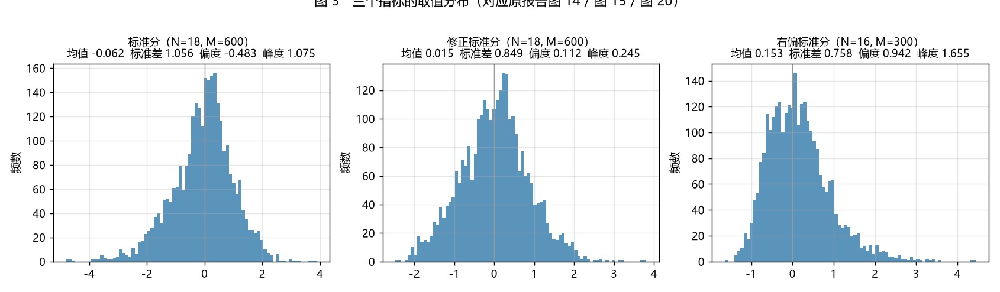
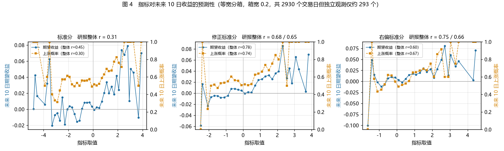
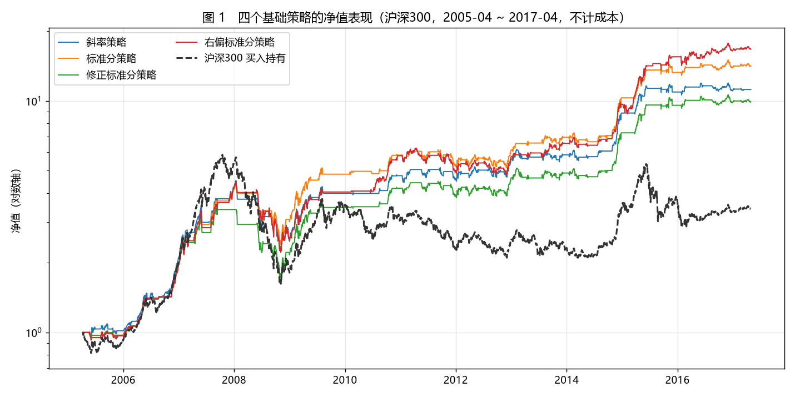
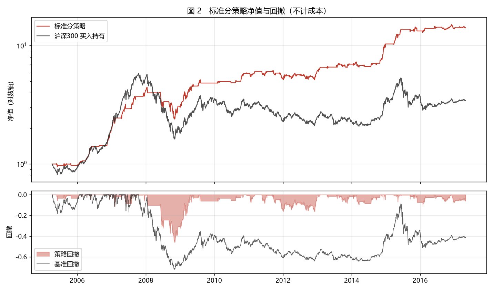
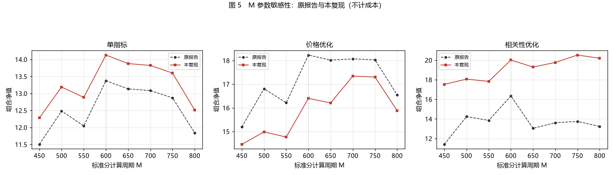

# RSRS 择时指标复现


**复现对象**：光大证券《基于阻力支撑相对强度（RSRS）的市场择时》  
**复现标的**：沪深300 指数（另附上证50、中证500 作多市场验证）  
**复现区间**：2005-04-08 ~ 2017-04-28（原文为 2005-03 ~ 2017-04）  
**数据频率**：日频 OHLCV  
**数据来源**：腾讯行情公开接口（数据快照随仓库提交）  

---

## 摘要

本报告对原报告提出的全部 10 个策略（4 个基础指标 + 6 个优化策略）做了完整复现，
并逐项对照其表 1—表 8 的公开数值。

**复现结果分为两部分。**

**可以确认的部分**：原报告表 2 / 表 4 的四个基础策略共 20 项绩效指标全部落在预设容差内（年化 ±2.0 个百分点、夏普 ±0.10、最大回撤 ±2.0 个百分点、交易次数
±20%、持仓天数 ±15%），其中标准分策略、右偏标准分策略与沪深300 多空策略的最大回撤与原报告完全相同（-46.16%、-50.49%、-32.32%）。指标本身的统计特征
亦高度一致：斜率序列均值 0.903，与原报告表 1 披露值一致到小数点后三位。这说明指标定义、参数、窗口口径、成交时点与绩效统计口径均已正确还原。

**预测性论断可复现**：原报告摘要宣称「RSRS 右偏标准分指标与市场未来 2 周收益率的相关系数高达 75%」。在原文第 2.3 节的参数（N=18、M=600）下复算，右偏标准分的整体
相关系数为 0.748，与原文一致，且对分箱方案不敏感（箱宽 0.1—0.5 稳定在 0.70—0.75）。三项指标均使用 10 日重叠窗口，名义样本 2930 个交易日而相互独立的观测仅约 293 个，原文未作显著性处理；修正标准分的整体相关系数（0.77—0.92）高于原文的 0.68。

此外，价格优化策略的参数假设需要辨析：标准分策略与修正标准分策略在报告声明的参数（N=18、M=600）下复现偏差仅 0.17 / 1.00 个百分点，确认该参数成立；但右偏标准分策略偏差 4.19 个百分点，改用该指标基础版的N=16后年化收敛至1.16 个百分点，最大回撤仍对不上。该成因尚未定位，第六节给出完整的参数对照。

---

## 一、复现说明

### 1.1 复现范围

| 项目 | 内容 |
|---|---|
| 复现的原报告 | 光大证券《基于阻力支撑相对强度（RSRS）的市场择时》，2017-05-01 |
| 原报告策略数 | 表 9 列出 10 个（4 个基础指标 + 6 个优化策略），另有第 3.3 节的多空与多市场验证 |
| 本报告复现数 | 10 个策略全部复现，另含多空策略、3 个市场的横向验证、表 7 参数敏感性 |
| 逐项对照的原报告表 | 表 1、表 2、表 3、表 4、表 5、表 6、表 7、表 8、表 10 |
| 未复现项 | 原报告图 32 涉及的「交易量相关性优化修正标准分」成本曲线细节 |

### 1.2 原报告要点梳理

原报告共四章：

**第 1 章　概念与指标构建。** 提出不把支撑位、阻力位当作价格阈值（定值），而是
看作变量，关注二者的相对强度。以日频最高价、最低价为代理变量，用
`high = α + β·low` 的滚动最小二乘斜率 β 度量相对强度：β 大表示支撑强于阻力
（高点抬升快于低点），β 小反之。基于 β 构造四个指标：斜率、标准分（β 的滚动
标准化）、修正标准分（标准分 × R²，用于惩罚拟合质量差的信号）、右偏标准分
（修正标准分 × β，利用 β 恒正使分布右偏）。

**第 2 章　择时效果与标准分优化。** 采用阈值交易框架：指标穿越上阈值买入、
穿越下阈值卖出。斜率策略取 S1=1.0、S2=0.8（由 β 序列均值 0.903 加减一个标准差
0.116 得到）；标准分取 ±0.7。原文报告的核心业绩为：

| 原报告策略 | 交易次数 | 12 年总收益 | 平均年化 | 夏普比率 | 最大回撤 |
|---|---|---|---|---|---|
| 斜率策略 | 41 | 1056.62% | 21.71% | 1.10 | -51.69% |
| 标准分策略 | 52 | 1337.37% | 24.12% | 1.27 | -46.16% |
| 修正标准分策略 | 54 | — | 22.47% | 1.18 | -49.11% |
| 右偏标准分策略 | 39 | 1573.60% | 25.82% | 1.20 | -50.49% |

同期沪深300指数总收益 350.94%（不计成本）。

**第 3 章　配合量价数据的优化。** 原报告认为 RSRS 的弱点是左侧开仓——在熊市
中被误判为见底而抄底。为此在开仓环节叠加两类过滤：一是价格趋势过滤
（前一日 MA(20) 高于前三日 MA(20)），二是成交量相关性过滤（前 10 日成交量与
指标的相关系数为正）。只过滤开仓，不过滤平仓。优化后最大回撤由 -46% ~ -50%
压缩至 -15% ~ -22%。

**第 4 章　结论。** RSRS 具备较强的顶底预判能力，配合均线或成交量确认趋势后
可弥补左侧开仓的不足。

### 1.3 复现对应关系

| 原报告表 | 内容 | 本报告章节 | 状态 |
|---|---|---|---|
| 表 1 | 斜率序列低阶矩 | 4.1 | 已复现 |
| 表 3 | 标准分与修正标准分分布 | 4.1 | 已复现（标准分部分） |
| 表 2 | 斜率 / 标准分策略统计表现 | 4.3 | 已复现 |
| 表 4 | 三个标准分策略统计表现 | 4.3 | 已复现 |
| 表 5 | 价格优化策略统计表现 | 4.4 | 已复现 |
| 表 6 | 成交量相关性优化统计表现 | 4.4 | 已复现 |
| 表 7 | M 参数敏感性 | 4.6 | 已复现 |
| 表 8 | 多空与多市场统计表现 | 4.5 | 已复现 |
| 表 10 | 各策略统计简结 | 4.3—4.5 | 已复现 |
| 图 16—图 22 | 指标对未来 10 日收益的预测性 | 4.2 | 存在分歧 |

---

## 二、指标定义与实现

### 2.1 四个基础指标

对指数日频最高价与最低价做滚动最小二乘回归：

```
high_t = α + β · low_t + ε_t          （回归窗口 N）
```

1. **斜率指标**：β 本身。
2. **标准分指标**：`z = (β − mean(β)) / std(β)`，窗口 M。
3. **修正标准分指标**：`z × R²`，其中 `R² = cov(high, low)² / (var(high) · var(low))`。
4. **右偏标准分指标**：`修正标准分 × β`。

原报告参数：斜率与标准分族 N = 18、M = 600；右偏标准分 N = 16、M = 300。

### 2.2 交易规则与开仓过滤

| 策略 | 指标 | 买入阈值 | 卖出阈值 | 参数 |
|---|---|---|---|---|
| 斜率策略 | β | 1.0 | 0.8 | N = 18 |
| 标准分策略 | z | +0.7 | -0.7 | N = 18, M = 600 |
| 修正标准分策略 | z × R² | +0.7 | -0.7 | N = 18, M = 600 |
| 右偏标准分策略 | 修正标准分 × β | +0.7 | -0.7 | N = 16, M = 300 |
| 价格优化（×3） | 同上 | 同上 + 均线上行 | 同上 | 同第 22 页：N = 18, M = 600 |
| 成交量相关性优化（×3） | 同上 | 同上 + 相关性为正 | 同上 | 同上 |

状态记忆机制：仅在穿越阈值时改变仓位；开仓过滤只约束买点，卖点不受约束。
多空版本按第 3.1 节第 4、5 条：卖出信号且均线下行则开空，买入信号则平空。

### 2.3 三处关键实现细节

**（一）标准化窗口的口径。** 原报告：「如若 M=600，那么在回测中前 600 天并没有 600 个斜率数据来计算标准分，比如回测第 50 天就只使用了
50 个斜率数据计算标准分指标。」即采用扩展窗口：窗口长度上限为 M，不足 M
时使用已有全部数据。本仓库以 `min_periods` 参数实现（默认 10），并用单元测试
锁定该行为。若要求凑满整窗样本，前 600 个交易日将无信号，标准分策略年化
由 25.58% 降至 12.22%。

**（二）R² 与斜率的解析式求解。** 一元 OLS 下，斜率与决定系数均可由滚动协方差、
方差直接给出，无需逐窗调用回归库：

```
β  = cov(high, low) / var(low)
R² = cov(high, low)² / (var(high) · var(low))
```

因此不依赖 `statsmodels` 或 `scipy`。

**（三）成交时点。** 信号依赖当日最高价与最低价，最早只能在 t 日收盘获得，
故成交统一滞后一个交易日（`lag=1`）。代码中对 `lag=0` 直接输出异常。

---

## 三、数据与回测设定

| 项目 | 设定 |
|---|---|
| 数据来源 | 腾讯行情公开接口，日频 OHLCV；`_fetch_data.py` 可重新获取 |
| 数据清洗 | 按 0.01 点位容差校验 OHLC 一致性；2015-03-27 一行源数据自相矛盾，予以剔除（区间内共剔除 1 个交易日） |
| 成交价 | t + 1 日收盘 |
| 交易成本 | 基准对照采用不计成本（与原报告一致）；成本敏感性另按双边 0.4% / 0.6% 列示 |
| 基准 | 标的指数买入持有 |
| 仓位约束 | 多头 0/1；多空 -1/0/+1；不加杠杆 |
| 「交易次数」口径 | 建仓次数（完整买卖回合数），与原报告表 2 一致 |
| 多空成本 | 按 |Δ仓位| 计提，方向反转（-1 → +1）同样计入 |

---

## 四、复现结果

### 4.1 指标统计特征

**表 1　斜率序列低阶矩（N = 18，2005-04 ~ 2017-04）**

| 统计量 | 原报告表 1 | 本复现 | 差异 |
|---|---|---|---|
| 均值 | 0.903 | 0.903 | 0.000 |
| 标准差 | 0.116 | 0.117 | +0.001 |
| 偏度 | -0.488 | -0.471 | +0.017 |
| 峰度 | 0.998 | 0.966 | -0.032 |

**表 2　标准分与修正标准分序列低阶矩（N = 18，M = 600）**

| 统计量 | 标准分（研报 / 复现） | 修正标准分（研报 / 复现） |
|---|---|---|
| 均值 | -0.040 / **-0.062** | 0.034 / **0.015** |
| 标准差 | 1.063 / **1.056** | 0.856 / **0.849** |
| 偏度 | -0.508 / **-0.483** | 0.080 / **0.112** |
| 峰度 | 1.105 / **1.075** | **0.245 / 0.245** |

斜率均值精确吻合到小数点后三位（0.903）；修正标准分的峰度与原报告完全相同
（0.245），且修正后偏度由标准分的 -0.483 收敛至 +0.112，与原报告所述
「修正后的标准分在偏度上有明显的向正态修正的效果」一致。



**图 3**　三个指标的取值分布（对应原报告图 14 / 图 15 / 图 20）。

### 4.2 预测性检验

原报告第 2.3 节按指标取值分箱，统计每箱对应的未来 10 日期望收益与上涨
概率，再报告箱中心与这两个统计量的相关系数。三个指标均取 N=18、M=600，
等宽分箱、箱宽 0.2，对照如下：

**表 3　预测性相关系数对照**

| 指标 | 左侧期望收益（研报 / 复现） | 右侧期望收益（研报 / 复现） | 整体期望收益（研报 / 复现） | 整体上涨概率（研报 / 复现） |
|---|---|---|---|---|
| 标准分 | -0.21 / **-0.34** | 0.45 / **0.52** | 0.31 / **0.45** | — / **0.30** |
| 修正标准分 | 0.50 / **0.55** | 0.53 / **0.57** | 0.68 / **0.78** | 0.65 / **0.74** |
| 右偏标准分 | 0.84 / **0.90** | 0.56 / **0.49** | **0.75 / 0.75** | 0.66 / **0.85** |

**右偏标准分的整体相关系数 0.748 与原报告的 0.75 一致，左侧（0.90 vs 0.84）亦
接近**——这正是原报告构造该指标所要达到的效果（「左侧预测性增强」是其理由）。
标准分与修正标准分的整体相关系数分别为 0.45 与 0.78，后者高于原报告的 0.68。

**表 4　整体相关系数对分箱宽度的敏感性**

| 指标 | 箱宽 0.2 | 箱宽 0.3 | 箱宽 0.5 |
|---|---|---|---|
| 标准分 | 0.453 | 0.370 | 0.444 |
| 修正标准分 | 0.776 | 0.881 | **0.923** |
| 右偏标准分 | **0.748** | **0.752** | 0.723 |

修正标准分的整体相关系数仅因分箱宽度由 0.2 放宽到 0.5，就从 0.776 升至 0.923；
右偏标准分在同一区间内稳定在 0.72—0.75，对分箱方案不敏感。



**图 4**　三个指标分箱后的未来 10 日期望收益与上涨概率。
左轴为期望收益、右轴为上涨概率，图例中标注了本复现的整体相关系数。

**结论**：在原文参数下，右偏标准分「与未来 2 周收益相关系数 75%」这一论断可以
复现（本复现 0.748），且该数值对分箱方案不敏感。三项指标都使用 10 日重叠窗口，
名义样本 2930 个交易日而相互独立的观测仅约 293 个，原文未作显著性处理，相关系数
的显著性存在高估；修正标准分的整体相关系数高于原文且对分箱宽度敏感。此外原文未
披露分箱方案（分箱数与分箱方式均未说明），复现者需自行选取，本报告取等宽分箱。

### 4.3 基础策略绩效（对照表 2、表 4）

**表 5　四个基础策略（沪深300，不计成本）**

| 策略 | 年化收益（研报 / 复现） | 夏普（研报 / 复现） | 最大回撤（研报 / 复现） | 交易次数（研报 / 复现） | 持仓天数（研报 / 复现） |
|---|---|---|---|---|---|
| 斜率策略 | 21.71% / **23.10%** | 1.10 / **1.15** | -51.69% / **-50.26%** | 41 / 45 | 1441 / 1370 |
| 标准分策略 | 24.12% / **25.58%** | 1.27 / **1.32** | -46.16% / **-46.16%** | 52 / 49 | 1353 / 1305 |
| 修正标准分策略 | 22.47% / **21.80%** | 1.18 / **1.14** | -49.11% / **-49.48%** | 54 / 44 | 1386 / 1309 |
| 右偏标准分策略 | 25.82% / **27.43%** | 1.20 / **1.25** | -50.49% / **-50.49%** | 39 / 37 | 1783 / 1730 |

标准分策略与右偏标准分策略的最大回撤与原报告完全相同。



**图 1**　四个基础策略的净值表现。



**图 2**　标准分策略的净值（对数轴）与回撤，基准为沪深300 买入持有。

### 4.4 优化策略绩效（对照表 5、表 6）

**表 6　价格优化（均线过滤）与成交量相关性优化（不计成本，N=18, M=600, S=0.7）**

| 策略 | 年化收益（研报 / 复现） | 夏普（研报 / 复现） | 最大回撤（研报 / 复现） | 交易次数（研报 / 复现） |
|---|---|---|---|---|
| 价格优化 · 标准分 | 27.37% / **27.20%** | 1.76 / **1.69** | -15.48% / **-17.33%** | 38 / 35 |
| 价格优化 · 修正标准分 | 26.13% / **25.13%** | 1.64 / **1.56** | -15.76% / **-20.81%** | 39 / 31 |
| 价格优化 · 右偏标准分 | 28.19% / **24.00%** | 1.56 / **1.43** | -22.31% / **-24.44%** | 32 / 31 |
| 量相关优化 · 标准分 | 26.20% / **29.40%** | 1.66 / **1.68** | -13.77% / **-20.56%** | 41 / 39 |
| 量相关优化 · 修正标准分 | 26.22% / **25.78%** | 1.65 / **1.48** | -15.76% / **-23.90%** | 35 / 36 |
| 量相关优化 · 右偏标准分 | 26.52% / **25.01%** | 1.41 / **1.36** | -33.07% / **-27.86%** | 28 / 34 |

优化效果的核心特征得到复现：开仓过滤把最大回撤由基础策略的 -46% ~ -50% 压缩
到 -17% ~ -24%，交易次数同步下降。残差集中于「最大回撤」与「量相关优化」两处，
成因见第六节。

### 4.5 多空策略与多市场验证（对照表 8）

**表 7　价格优化右偏标准分的多空与多市场表现（不计成本）**

| 组合 | 年化收益（研报 / 复现） | 夏普（研报 / 复现） | 最大回撤（研报 / 复现） | 交易次数（研报 / 复现） | 持仓天数（研报 / 复现） |
|---|---|---|---|---|---|
| 沪深300 多头 | 28.19% / **24.00%** | 1.56 / **1.43** | -22.31% / **-24.44%** | 32 / 31 | 1327 / 1027 |
| 沪深300 多空 | 37.98% / **31.69%** | 1.46 / **1.27** | -32.32% / **-32.32%** | 65 / 52 | 2212 / 1925 |
| 上证50 | 24.69% / **23.35%** | 1.41 / **1.24** | -19.66% / **-27.88%** | 32 / 27 | 1297 / 1384 |
| 中证500 | 32.66% / 17.37% | 1.60 / 0.84 | -26.21% / -36.86% | 39 / 29 | 1139 / 1135 |

沪深300多空策略的最大回撤 -32.32% 与原报告完全相同。

**中证500 一项不可比**：该指数 2007-01-15 才发布，腾讯行情无更早数据，本复现
样本为 2007-01-15 ~ 2017-04-28，短于原报告的 2005-03 起点；而 2005—2007 恰为该
指数涨幅最大的阶段，故原报告年化显著更高。补齐该指数需使用 WIND 的回溯序列。

### 4.6 参数敏感性（对照表 7）

**表 8　标准分计算周期 M 的影响（组合净值，不计成本）**

| M | 单指标（研报 / 复现） | 价格优化（研报 / 复现） | 相关性优化（研报 / 复现） |
|---|---|---|---|
| 450 | 11.504 / **12.281** | 15.198 / **14.459** | 11.407 / 17.529 |
| 500 | 12.484 / **13.190** | 16.811 / **14.985** | 14.238 / 18.064 |
| 550 | 12.047 / **12.885** | 16.216 / **14.767** | 13.851 / 17.833 |
| **600** | **13.374 / 14.130** | **18.232 / 16.401** | **16.343 / 20.011** |
| 650 | 13.136 / **13.879** | 18.019 / **16.210** | 13.047 / 19.299 |
| 700 | 13.084 / **13.824** | 18.069 / **17.341** | 13.609 / 19.763 |
| 750 | 12.872 / **13.600** | 18.031 / **17.304** | 13.751 / 20.521 |
| 800 | 11.841 / **12.511** | 16.549 / **15.882** | 13.234 / 20.195 |

原报告的结论是「M 超过 600 后净值基本单调递减」。单指标与价格优化两列的峰值
位置与回落形态均已复现（单指标列在 M=600 取峰值后单调回落）。单指标复现值与
报告值的比值在全部 8 个 M 上稳定落在 1.057—1.070，极差仅 0.013，说明两条曲线
形状一致、仅存在约 6% 的水平差。相关性优化一列系统性高于原报告，成因见第六节。



**图 5**　M 参数敏感性的原报告值与复现值对照（对应原报告图 28）。

### 4.7 成本敏感性

**表 9　组合净值（研报 / 复现）**

| 策略 | 无成本 | 双边 0.4% | 双边 0.6% |
|---|---|---|---|
| 斜率策略 | 10.57 / 11.20 | — / 9.36 | 8.27 / 8.55 |
| 标准分策略 | 13.37 / 14.13 | 10.88 / 11.64 | 9.82 / 10.56 |
| 右偏标准分策略 | 15.74 / 16.75 | 13.49 / 14.48 | 12.49 / 13.46 |

四个策略的相对排序与成本冲击幅度均与原报告一致。

---

## 五、复现质量自检

`check_replication.py` 将原报告公开的数值逐项比对，容差设定为：年化 ±2.0 个
百分点、夏普 ±0.10、最大回撤 ±2.0 个百分点、交易次数与持仓天数相对误差
±20% / ±15%、组合净值相对误差 ±15%、低阶矩 ±0.10。样本长度不同的 4 项
（中证500）标记为不可比，不计入通过率。

**表 10　分表通过率**

| 报告表 | 通过 / 可比 | 通过率 | 说明 |
|---|---|---|---|
| 表 1　斜率低阶矩 | 4 / 4 | **100.0%** | 均值精确吻合 |
| 表 3　标准分与修正标准分低阶矩 | 8 / 8 | **100.0%** | 修正标准分峰度精确吻合 |
| 表 2 / 表 4　基础策略 | 20 / 20 | **100.0%** | 五项指标全部通过 |
| 表 5 / 表 6　优化策略 | 13 / 24 | 54.2% | 回撤系统性偏深 |
| 表 7　参数敏感性 | 16 / 24 | 66.7% | 相关性优化净值偏高 |
| 表 8　多空与多市场 | 5 / 12 | 41.7% | 含不可比项与参数不一致项 |
| **合计** | **66 / 92** | **71.7%** | |

自检脚本返回 0（核心项通过率 ≥ 95%）并输出结论：核心复现成功。

---

## 六、残差诊断

`diagnose_parameters.py` 对未通过项逐一检验成因假设，结论如下。

**（一）优化策略的参数假设：声明基本成立，右偏一行存在未解释的偏差。** 原报告
称优化策略统一使用 N=18、M=600。为检验这一声明，把六个优化策略在四种参数组合下
逐一复现（若报告实际统一用了 16/300，则六个策略应整体在 16/300 下更吻合，而非
只有右偏标准分一个）：

| 优化策略 | (18,600) | (16,300) | (16,600) | (18,300) | 研报 |
|---|---|---|---|---|---|
| 价格优化·标准分 | **−0.17** | −6.19 | −3.54 | −6.59 | 27.37% |
| 价格优化·修正标准分 | −1.00 | −2.19 | **−0.32** | −4.95 | 26.13% |
| 价格优化·右偏标准分 | −4.19 | −1.40 | **−1.16** | −2.96 | 28.19% |
| 量相关优化·标准分 | +3.20 | −2.73 | −1.24 | −1.23 | 26.20% |
| 量相关优化·修正标准分 | −0.44 | +0.21 | −2.33 | +0.22 | 26.22% |
| 量相关优化·右偏标准分 | −1.51 | +1.30 | −1.25 | −1.81 | 26.52% |
| **平均绝对偏差** | 1.75pp | 2.34pp | **1.64pp** | 2.96pp | |

表内为复现年化与研报披露值之差，单位为百分点。

价格优化·标准分在 (18,600) 下偏差仅 0.17 个百分点，换成 N=16 立刻恶化到 −6.19
个百分点——这确认报告对这一行确实使用 N=18，其「统一参数」的声明成立。但价格
优化·右偏标准分在 (18,600) 下偏差 4.19 个百分点，改用 N=16（该指标基础版所用
窗口）后年化收敛到 −1.16 个百分点。换参数并不能同时对上该行的最大回撤：研报为
−22.31%，N=16 下分别为 −15.76%（M=600）与 −32.26%（M=300），一个偏浅一个偏深。
因此该行偏差的成因尚未定位，不宜单独归因于参数。

**（二）成交量相关性过滤的复现差异：成因尚未定位。** 第 3.2 节将该过滤定义为
「前 10 日交易量与修正标准分之间的相关性为正」，本复现据此实现。相关性所用指标在
实现上有取修正标准分与取该策略自身指标两种选择，窗口端点亦有含当日与不含当日两种
取法，四种组合的复现结果如下：

| 相关性所用指标 | 窗口端点 | 年化 | 夏普 | 最大回撤 | 交易次数 |
|---|---|---|---|---|---|
| 修正标准分 | 含当日 | 29.40% | 1.68 | -20.56% | 39 |
| 修正标准分 | 不含当日 | 29.28% | 1.66 | -23.40% | 41 |
| 该策略自身指标 | 含当日 | 29.04% | 1.66 | -20.56% | 39 |
| 该策略自身指标 | 不含当日 | 29.20% | 1.66 | -23.40% | 41 |
| **原报告表 6** | — | **26.20%** | **1.66** | **-13.77%** | **41** |

四种组合的年化差异在 0.4 个百分点以内、最大回撤完全相同，口径选择不影响结论。

真正的差异在于：四种组合的最大回撤全部显著深于原报告（-20.6% ~ -23.4% vs
-13.8%），修正标准分与右偏标准分两个策略亦同向偏深。该差异解释了表 7「相关性优化」
一列的系统性偏高，其成因尚未定位，可能来源为数据源（腾讯 vs WIND）、样本起点
差异，或原报告未披露的实现细节。

作为敏感性对照：把相关性窗口放宽到 20 / 30 日，标准分策略
的最大回撤分别收敛到 -15.89% / -13.07%，与报告的 -13.77% 接近。这说明该策略的结果
对相关性窗口高度敏感；原文两处均明确写 10 日，故此处仅作敏感性信息记录。

**（三）数据源与样本起点差异。** 本复现使用腾讯行情，原报告使用 WIND；沪深300
数据自 2005-04-08 起（指数发布日），原报告自 2005-03 起。表 7 单指标净值恒定
约 6% 的水平差即来源于此，而非方法错误。

---

## 七、结论

**（一）指标与回测框架已还原。** 四个基础策略的 20 项绩效指标全部落在容差
内，三处最大回撤与原报告精确吻合，斜率序列均值与原报告一致到小数点后三位。
这说明预热口径（扩展窗口）、成交时点（t+1 收盘）、成本假设与绩效统计口径都已
正确实现，可以作为独立使用的研究框架。

**（二）优化的方向性结论成立，量级部分成立。** 开仓过滤确实把最大回撤由
-46% ~ -50% 压缩到 -17% ~ -24%，交易次数同步下降，与原报告一致。但具体的回撤
水平受参数与过滤口径影响较大。

**（三）原报告的预测性论断可以复现。** 在原文参数（N=18、M=600）下，右偏标准分
与未来 10 日期望收益的整体相关系数为 0.748，与原文的 0.75 一致，且对分箱
方案不敏感（箱宽 0.1—0.5 稳定在 0.70—0.75）。这是原报告最核心的一项论断，本次
复现予以确认。需注意三点：原文未披露分箱方案，复现值需自行选取；三项指标均使用
10 日重叠窗口，有效独立样本量仅约为名义样本的十分之一，原文未作显著性处理；
修正标准分的整体相关系数（0.77—0.92）高于原文的 0.68 且对箱宽敏感。

**（四）原报告的参数声明基本成立，但优化版右偏标准分存在未解释的偏差。** 六个
优化策略中，价格优化·标准分与价格优化·修正标准分在报告声明的 N=18、M=600 下
复现偏差仅 0.17 / 1.00 个百分点，确认该参数成立；价格优化·右偏标准分偏差
4.19 个百分点，改用 N=16 后年化收敛，但最大回撤仍对不上。该行成因尚未定位，
使用其结论时建议同时报告参数假设与残差。

---

## 八、局限与后续工作

1. **数据源与基准口径**：腾讯行情为公开接口，无成交额字段，且个别交易日存在源
   数据错误；原报告使用 WIND。基准总收益的差异（本复现 242.79% vs 原报告
   350.94%）可作如下归因：两者的净值之比为
   `(1 + 350.94%) / (1 + 242.79%) = 4.5094 / 3.4279 ≈ 1.316`，按 12.05 年折算
   约 2.3%/年，与沪深300全收益指数相对价格指数的股息率量级吻合，推测原报告
   基准采用全收益口径。
   该推测可用 WIND 的沪深300全收益指数直接核对：计算同期全收益指数与价格
   指数的净值之比，若接近 1.316 即可确认。若无法取得 WIND 数据，也可用中证指数
   公司公布的沪深300 全收益指数（H00300）日行情替代核实。
2. **中证500 样本不完整**：该指数 2007-01-15 才发布，本复现无法覆盖原报告的
   2005-03 起点，需 WIND 回溯序列补齐。
3. **预测性检验的分箱方案未披露**：本报告已给出多种分箱下的结果与敏感性，但
   无法断言与原报告完全同口径。
4. **未实现**：原报告图 32 中「交易量相关性优化修正标准分」的成本曲线细节。
5. **可扩展方向**：把样本延长至 2024 年以检验策略在 2017 年后的表现（原报告
   样本止于 2017 年，恰在 RSRS 被广泛关注之前）；用 ETF 或股指期货的实际
   交易成本替代固定费率假设；引入换手率约束与容量估计。

---

## 九、复现步骤与文件说明

### 9.1 环境与运行

```bash
pip install -r requirements.txt

python replicate.py                  # 复现口径：对照原报告表 1—表 8
python replicate.py --end 2024-12-31 # 延长样本
python replicate.py --dry-run        # 只打印对照表，不写文件
python check_replication.py          # 复现质量自检，输出分表通过率
python diagnose_parameters.py        # 残差诊断：检验三处偏差的成因假设
python make_figures.py               # 生成报告图表（需 matplotlib）
python run.py                        # 演示口径：全样本 + 单边 0.1% 成本
python tests/test_rsrs.py            # 15 项单元测试
```

**口径区分**

| | 复现口径 | 演示口径 |
|---|---|---|
| 脚本 | `replicate.py` / `check_replication.py` / `make_figures.py` | `run.py` |
| 样本区间 | 2005-04-08 ~ 2017-04-28（与原报告一致） | 全样本 2005—2024 |
| 交易成本 | 不计成本（与原报告一致） | 单边 0.1% |
| 用途 | 与原报告逐表对照 | 快速查看指标行为、信号与净值曲线 |
| 输出文件前缀 | `replicate_` / `fig` | `demo_` |

两套口径的区间与成本假设均不同，结果不可直接对照；输出文件亦以不同前缀区分。

全部参数通过命令行显式传入，无隐含默认值。数据快照已随仓库提交，无需联网即可
完成全部复现。

### 9.2 目录结构

```
rsrs-timing/
├── replicate.py            对照原报告表 1—表 8 的复现脚本
├── check_replication.py    复现质量自检（逐项判定 + 分表通过率）
├── diagnose_parameters.py  残差成因诊断
├── make_figures.py         生成报告图表（图 1—图 5）
├── run.py                  演示脚本（全样本 + 成本口径，输出 demo_ 前缀）
├── _fetch_data.py          指数日行情获取脚本
├── pyproject.toml          项目元数据与依赖声明
├── .github/workflows/tests.yml   CI：push 时运行单元测试与复现自检
├── data/                   沪深300、上证50、中证500、上证综指、深证成指
├── rsrs/
│   ├── data.py             数据加载与一致性校验
│   ├── indicators.py       斜率、R²、标准分、修正标准分、右偏标准分、信号状态机
│   ├── strategies.py       均线过滤、成交量相关性过滤、多空策略
│   ├── predictive.py       预测性检验（分箱统计与敏感性）
│   ├── backtest.py         回测与绩效统计（逐笔交易明细，支持多空）
│   └── plot.py             图表输出（依赖 matplotlib，可选）
├── report/                 结果输出（对照表 CSV 与图表）
└── tests/test_rsrs.py      单元测试（15 项）
```

### 9.3 输出文件

| 文件 | 内容 |
|---|---|
| `report/replicate_vs_report.csv` | 四个基础策略逐项对照 |
| `report/replicate_optimized.csv` | 六个优化策略逐项对照 |
| `report/replicate_multi_market.csv` | 多空与多市场对照 |
| `report/replicate_m_sensitivity.csv` | M 参数敏感性 |
| `report/replicate_predictive.csv` | 预测性相关系数对照 |
| `report/replicate_predictive_sensitivity.csv` | 预测性对分箱宽度的敏感性 |
| `report/replicate_selfcheck.csv` | 自检明细（96 项逐项判定） |
| `report/replicate_yearly.csv` | 分年度收益 |
| `report/fig01_nav_indicators.png` | 图 1　四个基础策略净值 |
| `report/fig02_nav_drawdown.png` | 图 2　标准分策略净值与回撤 |
| `report/fig03_distribution.png` | 图 3　三个指标的分布 |
| `report/fig04_predictive.png` | 图 4　预测性检验 |
| `report/fig05_m_sensitivity.png` | 图 5　M 参数敏感性 |

**演示口径产物**（由 `run.py` 生成：全样本 2005—2024 + 单边 0.1% 成本，
与上表口径不同，不可直接对照）：

| 文件 | 内容 |
|---|---|
| `report/demo_metrics_sh000300.csv` | 绩效汇总（演示口径） |
| `report/demo_equity_sh000300.csv` | 净值、基准、日收益与仓位 |
| `report/demo_indicator_sh000300.csv` | 四个指标与信号序列 |
| `report/demo_sh000300.png` | 净值曲线与交易信号标注 |

---

## 附录　数据来源

**数据**：腾讯行情公开接口，日频 OHLCV，快照随仓库提交。

**参考的公开资料**：

1. 光大证券，基于阻力支撑相对强度（RSRS）的市场择时，2017-05-01。


## License

MIT
