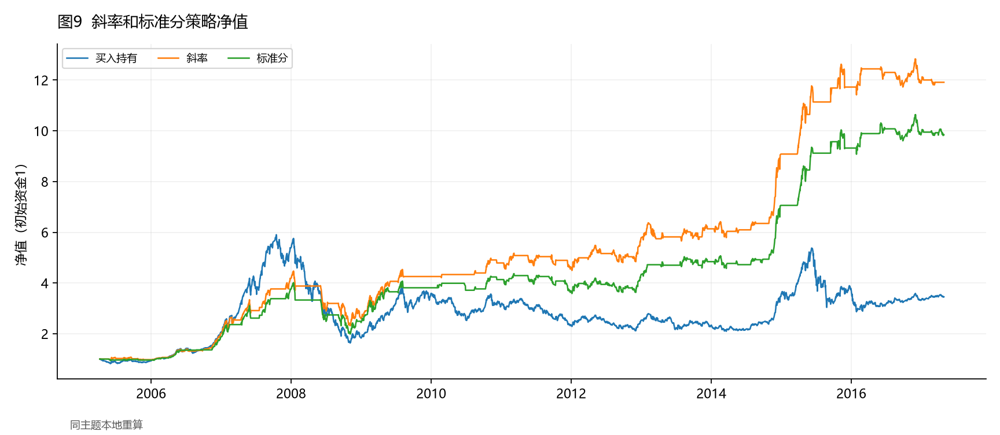
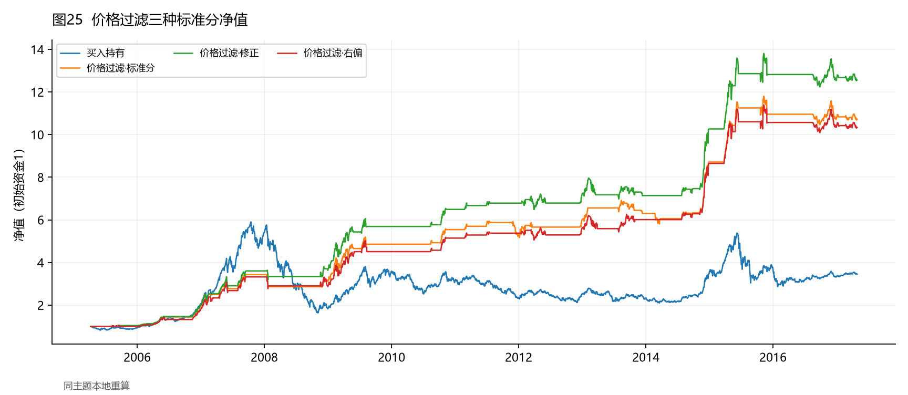

# RSRS市场择时：按光大2017年研报结构复现

本项目复现光大证券2017-05-01《基于阻力支撑相对强度（RSRS）的市场择时》。**原研报做什么，主报告按相同章节研究什么：概念与构造 → 初步择时 → 指标修正 → 量价过滤 → 多空及其它市场 → 结论。**

**从这里阅读：[按原研报顺序的完整复现报告](report/paper/report.md)。** 全部32个图主题、10张表及结果解释集中在这一份报告中；图3—6是概念示意，分箱与数据缺口等不能精确复刻的事项明确披露。无需先读代码或分散的CSV。

**后续研究：[策略失效诊断与后验改进](report/improvement/report.md)。** 结合2019年作者的回顾与改进，检验波动率钝化，并提出滚动分位数与长期趋势约束的状态自适应RSRS。该部分明确标注为看到后续历史后的改进研究，不冒充盲样本外结果。

## 1、阻力支撑相对强度概念

对应原文1.1—1.4节：先重建布林带(14,2)和MA20对照，再说明高低价作为代理变量的理由、四种市场状态示意以及滚动OLS斜率与标准分的构造。输出图1—8、表1。

## 2、RSRS指标择时初步效果

对应2.1—2.3节：斜率和标准分阈值策略、完整按天/按次交易统计、成本冲击、N=14—25扫描、2008年与2009—2014年行情复盘，再研究R²修正及右偏变换。

预测性主分析遵循原文的**按指标水平汇总未来10日上涨概率和期望收益**，不是用逐日IC或HAC检验代替原文。原文未披露精确分箱，采用参考notebook的50个等宽箱并公开各箱样本数。输出图9—24、表2—4。



## 3、RSRS指标配合量价数据优化策略

- **3.1 价格趋势过滤**：三种指标统一18/600/±0.7，只过滤开仓；输出图25—26、表5。
- **3.2 成交量相关性过滤**：前10日成交量与修正标准分正相关；补齐M=450—800、步长50的三类策略比较；输出图27—28、表6—7。
- **3.3 多空及其它市场**：沪深300价格过滤右偏多空，上证50及中证500价格过滤右偏多头，包含原文双边0.6%费用情景；输出图29—31、表8。



## 4、结论

沪深300主期实际为2005-04-08—2017-04-28，**下表按原文主表不计成本**。

| 策略 | 年化收益率 | 夏普比率 | 最大回撤 |
| --- | --- | --- | --- |
| 买入持有 | 11.25% | 0.514 | -72.30% |
| 斜率 | 23.74% | 1.172 | -48.20% |
| 标准分 | 21.72% | 1.135 | -50.50% |
| 修正标准分 | 21.44% | 1.126 | -45.12% |
| 右偏(16,300) | 22.97% | 1.069 | -56.40% |
| 价格过滤·右偏 | 22.23% | 1.359 | -16.55% |
| 量过滤·右偏 | 22.41% | 1.323 | -17.85% |

原报告期内，基础策略有较高历史收益，但回撤仍大；量价过滤改善部分风险收益表现。指标分箱关系、策略排序和参数最优点应以本地结果判断，不能因为原文得到某结论就要求复现也成立。图32与表9—10汇总策略规则和表现。

## 如何复现

```bash
python -m pip install -r requirements.txt
python paper.py
python tests/test_rsrs.py
python tests/test_research.py
python tests/test_paper.py
python tests/test_improvement.py
python check_replication.py
python improve.py
python check_improvement.py
```

使用仓库固定数据，无需账户、网络或token。`python paper.py --no-plots --outdir /tmp/rsrs-paper`只计算不绘图。`replicate.py`与`make_figures.py`也转到同一主入口，避免多套成交口径。原始行情替换用`--data-dir`，CSV格式为date/open/high/low/close/volume；不会自动填补缺失年份。

| 路径 | 内容 |
| --- | --- |
| [report/paper/report.md](report/paper/report.md) | 唯一主报告，按原文1—4章阅读全文 |
| [docs/paper_mapping.md](docs/paper_mapping.md) | 图1—32、表1—10逐项定位与差异 |
| [docs/methodology.md](docs/methodology.md) | 数据、日期、预热、成交和交易统计约定 |
| [report/paper/coverage.csv](report/paper/coverage.csv) | 可机器核查的42项覆盖清单 |
| report/paper/figures、tables、data | 所有图片、原文式表格、逐日明细及核账 |
| [report/research/report.md](report/research/report.md) | 独立附录：延长样本与额外检验 |
| [report/improvement/report.md](report/improvement/report.md) | 2019改进复核、失效归因与自有候选策略 |

## 口径与复现边界

主表无交易费；成本情景单边0.2%/0.3%。t收盘产生信号，t+1收盘成交，新仓位不赚取成交之前的收益。第3.3节独立截至2017-03-31；其他主要结果截至2017-04-28。延长样本附录固定单边0.1%，其数值不能直接与主文无费表混比。

原文采用WIND，本项目采用腾讯价格指数数据。沪深300缺2005年3月，中证500缺2005—2006年；原文未披露精确分箱与全部成交细节，表7、图32的歧义也已注明。主报告完成逐项研究内容，不宣称逐数值复刻。没有为了对齐原文业绩调参。

继续计算独立附录：`python research.py`。附录中原报告期与发表后共用相同策略参数、过滤、预热、执行和费用；它不回写或替代主报告。

## 研究来源

原始研报：光大证券，2017-05-01，《择时系列报告之一：基于阻力支撑相对强度（RSRS）的市场择时》。原始PDF不随仓库转载。

实现参考：[hugo2046/QuantsPlaybook RSRS notebook](https://github.com/hugo2046/QuantsPlaybook/blob/master/C-%E6%8B%A9%E6%97%B6%E7%B1%BB/RSRS%E6%8B%A9%E6%97%B6%E6%8C%87%E6%A0%87/py/RSRS.ipynb)。章节组织和等宽分箱作为参考，信号、费用、交易统计和敏感性计算独立实现；[参考差异说明](docs/reference_notes.md)。
