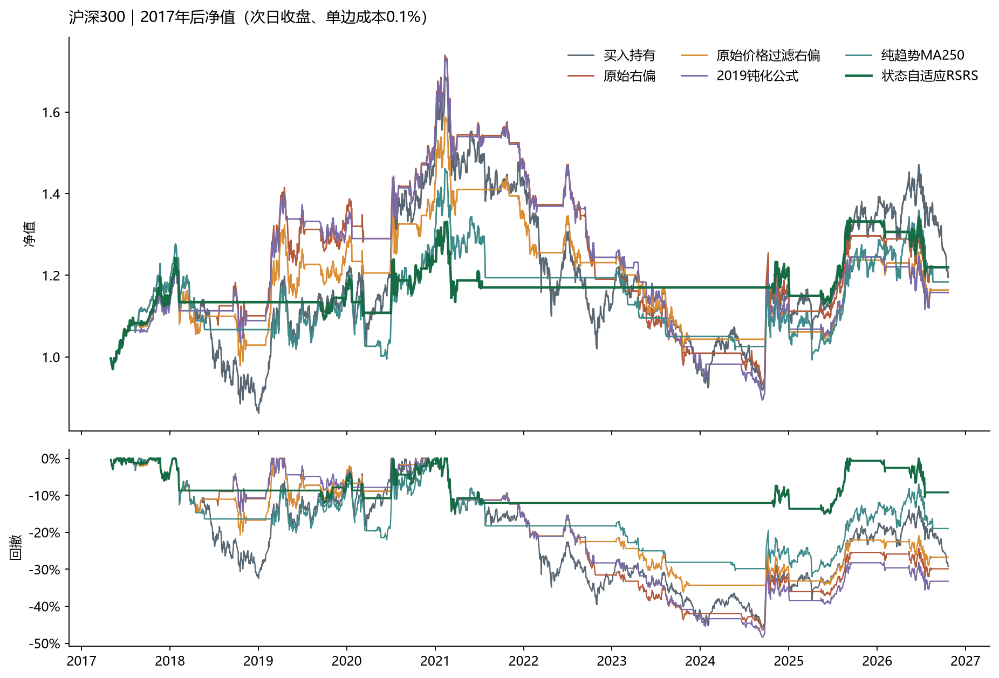
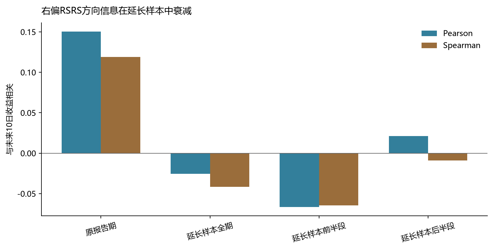

# RSRS策略评价、失效诊断

本报告在完成原研报复现后，评价原规则在**2017-05-02至2026-10-21**延长样本中的有效性，诊断表现变化的原因，并检验可解释的改进。原报告期仅用于建立参照；全部核心评价、参数敏感性、跨市场检验和统计检验都以完整的2017—2026延长样本为主。所有策略统一采用t日收盘形成信号、t+1日收盘执行、单边成本0.1%、现金收益0。

## 1. 结论先行

1. **沪深300基准已按完整评价期重新核对。** 首个收益观察日为2017-05-02，以此前交易日收盘3439.750为基数，期末收盘为4111.930；累计收益19.54%、按252个交易日年化1.97%。该数值与回测表的连续买入持有账户一致，并非0.8%。
2. **原策略在延长样本中没有稳定跑赢市场。** 买入持有年化1.97%；原始右偏RSRS年化2.20%，但最大回撤-46.43%；原始价格过滤右偏年化1.68%，低于基准。
3. **失效首先表现为指标方向信息衰减。** 右偏RSRS与次日执行后未来10日收益的Pearson相关系数从原报告期的0.150下降到延长样本全期的-0.025。当排序关系接近零时，调整固定阈值只能改变交易频率，无法恢复预测方向。

## 2. 基准收益核对

| 首个收益观察日 | 起算基准日 | 结束日 | 交易日数 | 起算收盘 | 期末收盘 | 指数累计收益 | 指数年化收益 | 回测买入持有累计收益 | 回测买入持有年化收益 |
| --- | --- | --- | --- | --- | --- | --- | --- | --- | --- |
| 2017-05-02 | 2017-04-28 | 2026-10-21 | 2300 | 3439.75 | 4111.93 | 19.54% | 1.97% | 19.54% | 1.97% |

评价期首日的日收益来自上一个交易日收盘，因此核对表用2017-04-28收盘作为起算基数，与策略收益序列完全对齐。年化统一采用252个交易日口径。买入持有在评价期开始前已经处于持仓状态，期内没有换手成本；策略也同样保留此前历史形成的状态。这样既保留指标预热，也避免各策略在分段边界被人为重置。

## 3. 为什么原策略在延长样本中表现变差

### 3.1 指标的方向信息衰减

| 分期 | 样本数 | Pearson | Spearman |
| --- | --- | --- | --- |
| 原报告期 | 2876 | 0.150 | 0.119 |
| 延长样本全期 | 2289 | -0.025 | -0.042 |
| 延长样本前半段 | 1129 | -0.067 | -0.065 |
| 延长样本后半段 | 1149 | 0.021 | -0.009 |

RSRS依赖“指标越高，未来收益越高”的排序关系。该关系在延长样本中接近零后，改阈值只能改变交易频率，无法恢复方向性。波动钝化可以减少弱信号触发，但不会创造新的预测信息。

### 3.2 固定绝对阈值不适应指标分布漂移

原规则长期固定±0.7。当波动、R²和beta分布改变时，±0.7所代表的历史极端程度也改变。结果可能是某些阶段长期不触发，另一些阶段频繁触发。改进方案因此使用只含过去数据的滚动经验分位数。

### 3.3 高低价结构不能单独代表市场趋势

同一种RSRS形态可出现在上涨、反弹、下跌中继和震荡。交易账本显示，延长样本中的部分持仓发生在长期趋势走弱阶段；仅过滤开仓、却不在长期趋势破坏时退出，会放大这种错误。

| 策略 | 分期 | 交易段数 | 胜率 | 平均每段收益 | 平均持有日 |
| --- | --- | --- | --- | --- | --- |
| 原始右偏 | 原报告期 | 40 | 62.50% | 6.06% | 35.475 |
| 原始右偏 | 延长样本全期 | 23 | 52.17% | 1.36% | 54.304 |
| 原始右偏 | 延长样本前半段 | 14 | 71.43% | 3.19% | 47.786 |
| 原始右偏 | 延长样本后半段 | 10 | 20.00% | -1.36% | 58.000 |
| 波动钝化RSRS | 原报告期 | 45 | 57.78% | 5.33% | 29.911 |
| 波动钝化RSRS | 延长样本全期 | 27 | 37.04% | 1.00% | 40.815 |
| 波动钝化RSRS | 延长样本前半段 | 14 | 50.00% | 3.22% | 38.929 |
| 波动钝化RSRS | 延长样本后半段 | 14 | 21.43% | -1.30% | 39.786 |
| 状态自适应RSRS | 原报告期 | 19 | 63.16% | 8.44% | 19.158 |
| 状态自适应RSRS | 延长样本全期 | 17 | 58.82% | 1.57% | 33.412 |
| 状态自适应RSRS | 延长样本前半段 | 12 | 66.67% | 1.64% | 31.167 |
| 状态自适应RSRS | 延长样本后半段 | 5 | 40.00% | 1.38% | 38.800 |

### 3.4 空仓的收益与代价不对称

| 策略 | 分期 | 错过上涨日收益之和 | 规避下跌日损失之和 | 成本之和 | 平均仓位 |
| --- | --- | --- | --- | --- | --- |
| 原始右偏 | 延长样本全期 | 433.84% | 433.50% | 4.50% | 54.30% |
| 原始右偏 | 延长样本后半段 | 227.67% | 225.02% | 1.90% | 50.00% |
| 波动钝化RSRS | 延长样本全期 | 507.08% | 501.09% | 5.30% | 47.91% |
| 波动钝化RSRS | 延长样本后半段 | 236.91% | 230.04% | 2.70% | 48.02% |
| 状态自适应RSRS | 延长样本全期 | 748.63% | 741.35% | 3.30% | 24.70% |
| 状态自适应RSRS | 延长样本后半段 | 381.60% | 398.78% | 1.00% | 16.72% |

这里的日收益加总是归因量，不等于复合收益。它用于判断空仓规避的下跌，是否足以补偿错过的上涨与交易成本。
