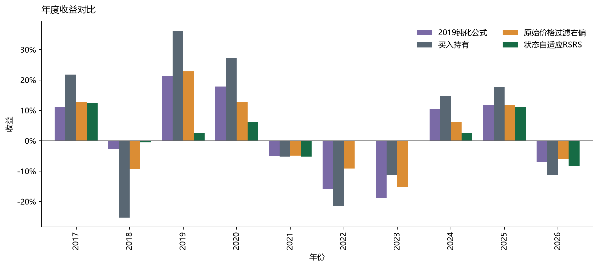
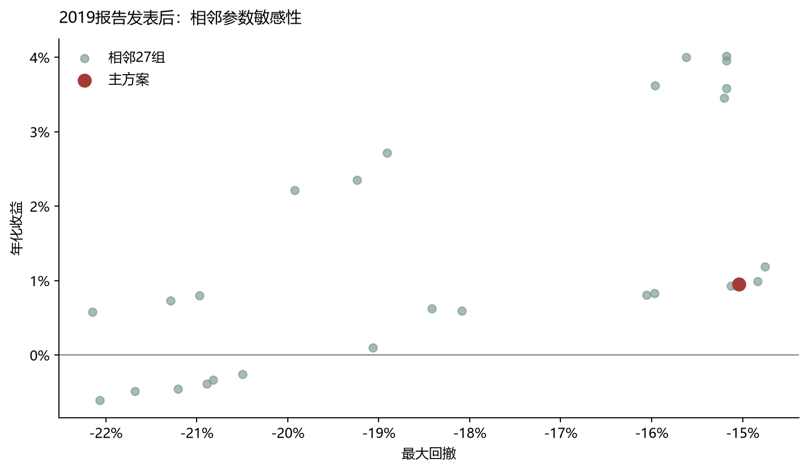

# RSRS策略评价、失效诊断与后验改进

本报告承接原研报复现，但研究问题已经改变：不再检验“是否复现”，而是评价固定RSRS规则为什么在后续失效，并提出可解释的改进。所有策略仍采用t日收盘形成信号、t+1日收盘执行、单边成本0.1%、现金收益0。

**证据边界：**我们是在已经看到2017年后失效的情况下设计改进，参数选择也参考了历史结果，因此2017—2026是后验研究区间，不是事前注册的盲样本外。代码不存在未来函数，规则在各分期不变，但这只能证明历史计算可执行。2026年之后的新数据才构成真正的前瞻检验。

## 1. 结论先行

1. **主要失效来自预测关系衰减。**右偏RSRS对次日执行后未来10日收益的相关性在开发期为0.150，2019报告发表后为-0.045。固定阈值面对的已不是同一种稳定映射。
2. **2019年的波动率钝化只解决震荡误触发的一部分。**固定原参数复现该公式后，2017—2019年表现改善；2019-11-14以后年化-1.79%、最大回撤-48.43%，说明单独压缩高波动信号不足以应对长期结构变化。
3. **状态自适应RSRS在后验历史中的改善主要体现在风险收益质量。**2019报告发表后年化0.96%、夏普0.147、最大回撤-15.04%；同期买入持有年化0.80%、最大回撤-45.60%。2022年以来，改进策略年化0.90%，同期市场-3.91%。
4. **证据仍不足以宣称发现稳定的新因子。**改进策略平均仓位较低，收益差的区间可能因少持仓而被动降低；块bootstrap区间较宽，参数邻域表现也存在差异。更准确的结论是：长期趋势约束和滚动尺度校准显著降低了原规则的错误暴露，当前样本下改善了回撤和近期收益。

## 2. 2019年报告提供了什么

2019年报告把问题定位为震荡行情下信号频繁切换、胜率下降。它测试三类加权回归：时间线性权重和指数权重总体无效，成交额加权对中证500、创业板更有帮助，对沪深300等大盘指数提升有限。较有效的方案是“钝化RSRS”：

`damped = z × (R²)^(2q)`，其中q是N日收益波动率在过去M日的分位数。波动越高，R²被提高到更大的幂，指标越靠近零，从而减少震荡期触发。

报告为沪深300重选了18/700/0.7，但该选择使用了截至2019年的数据。若从2017年开始评价，它含有未来信息。这里仅借用公式，继续固定2017年原参数18/600/±0.7。2019年报告发表后的区间是作者当时未见的数据，但对我们当前研究仍是已经观察到的历史。

## 3. 为什么原策略后来表现不好

### 3.1 指标的方向信息消失

| 分期 | 样本数 | Pearson | Spearman |
| --- | --- | --- | --- |
| 开发期 | 2876 | 0.150 | 0.119 |
| 2019报告跟踪期 | 609 | 0.033 | -0.013 |
| 2019报告发表后 | 1669 | -0.045 | -0.061 |
| 发表后全部 | 2289 | -0.025 | -0.042 |
| 近期 | 1149 | 0.021 | -0.009 |

RSRS最初依赖“指标越高，未来收益越高”的排序关系。该关系接近零后，改阈值只能改变交易频率，无法恢复方向性。2019钝化将弱信号压回零，但不会创造新的预测信息。

### 3.2 固定绝对阈值不适应指标分布漂移

原规则长期固定±0.7。当波动、R²和beta分布改变时，±0.7所代表的历史极端程度也改变。结果可能是某些阶段长期不触发，另一些阶段频繁触发。改进方案因此使用只含过去数据的滚动经验分位数。

### 3.3 原规则把“高低价结构”直接当成市场方向

RSRS描述日内高低价关系，但同样的形态可出现在反弹、下跌中继和震荡。2019报告发现的震荡误判是其中一种表现。我们的交易账本还显示，2021年底至2023年的多笔持仓在长期下行趋势中持续亏损；仅过滤开仓、却不在长期趋势破坏时退出，会放大这种错误。

| 策略 | 分期 | 交易段数 | 胜率 | 平均每段收益 | 平均持有日 |
| --- | --- | --- | --- | --- | --- |
| 原始右偏 | 开发期 | 40 | 62.50% | 6.06% | 35.475 |
| 原始右偏 | 2019报告发表后 | 17 | 41.18% | 0.17% | 48.882 |
| 原始右偏 | 近期 | 10 | 20.00% | -1.36% | 58.000 |
| 2019钝化公式 | 开发期 | 45 | 57.78% | 5.33% | 29.911 |
| 2019钝化公式 | 2019报告发表后 | 21 | 33.33% | -0.17% | 38.095 |
| 2019钝化公式 | 近期 | 14 | 21.43% | -1.30% | 39.786 |
| 状态自适应RSRS | 开发期 | 19 | 63.16% | 8.44% | 19.158 |
| 状态自适应RSRS | 2019报告发表后 | 13 | 46.15% | 0.92% | 28.154 |
| 状态自适应RSRS | 近期 | 5 | 40.00% | 1.38% | 38.800 |

### 3.4 表现落后来自“错过上涨”和“未充分规避下跌”的不对称

| 策略 | 分期 | 错过上涨日收益之和 | 规避下跌日损失之和 | 成本之和 | 平均仓位 |
| --- | --- | --- | --- | --- | --- |
| 原始右偏 | 2019报告发表后 | 351.42% | 338.50% | 3.30% | 49.46% |
| 原始右偏 | 近期 | 227.67% | 225.02% | 1.90% | 50.00% |
| 2019钝化公式 | 2019报告发表后 | 368.86% | 349.81% | 4.10% | 47.62% |
| 2019钝化公式 | 近期 | 236.91% | 230.04% | 2.70% | 48.02% |
| 状态自适应RSRS | 2019报告发表后 | 539.48% | 534.42% | 2.60% | 21.79% |
| 状态自适应RSRS | 近期 | 381.60% | 398.78% | 1.00% | 16.72% |

这里的日收益加总是归因量，不等于复合收益。它帮助回答策略为何落后：空仓能否规避的下跌，是否足以补偿被错过的上涨与成本。

## 4. 自有改进：状态自适应RSRS

改进保留18/600右偏RSRS本体，不用2017年后的收益重估beta或拟合预测模型。规则为：

- **尺度校准：**把当日右偏RSRS转换为过去756个交易日约三年的经验分位数，最少252日才启用。
- **开仓：**指标处于前20%，收盘价高于MA250，并且MA250高于20日前。
- **平仓：**指标落入后20%，或收盘价跌破MA250；二者任一成立即退出。
- **执行：**条件都由当日及过去数据计算，次日收盘成交。参数在所有后续时期和三个指数上保持不变。

这个结构分别解决三个问题：滚动分位数处理量纲漂移，长期均线区分趋势状态，非对称退出避免RSRS在长期下行中继续持仓。MA250单独列作控制，以判断改善是否只是普通趋势策略。

## 5. 全部分期结果

| 分期 | 策略 | 累计收益 | 年化收益 | 夏普 | 最大回撤 | 平均绝对仓位 | 年均单边换手 |
| --- | --- | --- | --- | --- | --- | --- | --- |
| 开发期 | 买入持有 | 245.21% | 11.24% | 0.513 | -72.30% | 99.93% | 0.086 |
| 开发期 | 原始右偏 | 567.56% | 17.73% | 0.918 | -50.24% | 48.41% | 6.792 |
| 开发期 | 原始价格过滤右偏 | 883.26% | 21.72% | 1.331 | -16.63% | 32.14% | 4.213 |
| 开发期 | 2019钝化公式 | 551.38% | 17.48% | 0.921 | -50.44% | 45.92% | 7.652 |
| 开发期 | 纯趋势MA250 | 358.94% | 14.00% | 0.743 | -43.14% | 48.24% | 4.041 |
| 开发期 | 状态自适应RSRS | 264.17% | 11.75% | 1.107 | -17.14% | 12.42% | 3.181 |
| 2019报告跟踪期 | 买入持有 | 13.38% | 5.24% | 0.363 | -32.46% | 100.00% | 0.000 |
| 2019报告跟踪期 | 原始右偏 | 28.71% | 10.80% | 0.721 | -15.30% | 67.42% | 4.877 |
| 2019报告跟踪期 | 原始价格过滤右偏 | 20.32% | 7.81% | 0.557 | -20.82% | 65.48% | 4.065 |
| 2019报告跟踪期 | 2019钝化公式 | 30.63% | 11.47% | 0.889 | -15.07% | 48.71% | 4.877 |
| 2019报告跟踪期 | 纯趋势MA250 | 11.46% | 4.51% | 0.391 | -20.17% | 68.06% | 2.439 |
| 2019报告跟踪期 | 状态自适应RSRS | 14.48% | 5.65% | 0.836 | -12.09% | 32.58% | 2.845 |
| 2019报告发表后 | 买入持有 | 5.43% | 0.80% | 0.136 | -45.60% | 100.00% | 0.000 |
| 2019报告发表后 | 原始右偏 | -5.25% | -0.81% | 0.009 | -46.43% | 49.46% | 4.950 |
| 2019报告发表后 | 原始价格过滤右偏 | -3.26% | -0.50% | 0.024 | -36.21% | 42.02% | 4.050 |
| 2019报告发表后 | 2019钝化公式 | -11.37% | -1.79% | -0.068 | -48.43% | 47.62% | 6.150 |
| 2019报告发表后 | 纯趋势MA250 | 6.20% | 0.91% | 0.135 | -32.05% | 52.74% | 6.150 |
| 2019报告发表后 | 状态自适应RSRS | 6.55% | 0.96% | 0.147 | -15.04% | 21.79% | 3.900 |
| 发表后全部 | 买入持有 | 19.54% | 1.97% | 0.198 | -45.60% | 100.00% | 0.000 |
| 发表后全部 | 原始右偏 | 21.96% | 2.20% | 0.223 | -46.43% | 54.30% | 4.930 |
| 发表后全部 | 原始价格过滤右偏 | 16.40% | 1.68% | 0.190 | -36.21% | 48.35% | 4.054 |
| 发表后全部 | 2019钝化公式 | 15.78% | 1.62% | 0.187 | -48.43% | 47.91% | 5.807 |
| 发表后全部 | 纯趋势MA250 | 18.38% | 1.87% | 0.201 | -32.05% | 56.87% | 5.150 |
| 发表后全部 | 状态自适应RSRS | 21.97% | 2.20% | 0.289 | -15.04% | 24.70% | 3.616 |
| 近期 | 买入持有 | -16.77% | -3.91% | -0.131 | -36.05% | 100.00% | 0.000 |
| 近期 | 原始右偏 | -17.70% | -4.14% | -0.251 | -37.13% | 50.00% | 4.128 |
| 近期 | 原始价格过滤右偏 | -14.10% | -3.25% | -0.208 | -25.22% | 42.41% | 3.259 |
| 近期 | 2019钝化公式 | -21.65% | -5.16% | -0.337 | -39.47% | 48.02% | 5.866 |
| 近期 | 纯趋势MA250 | -0.86% | -0.19% | 0.049 | -18.05% | 43.97% | 6.952 |
| 近期 | 状态自适应RSRS | 4.22% | 0.90% | 0.161 | -10.49% | 16.72% | 2.172 |

状态自适应RSRS在2019报告发表后略高于买入持有，同时显著降低最大回撤；与纯MA250相比，最大回撤也明显更小，说明结果不是完全由均线贡献。但低仓位是收益稳定的重要来源，应把它理解成防御型择时，不应把低回撤全部归因于RSRS预测能力。

## 6. 参数邻域与跨市场

主方案选择三年分位窗口、MA250和80/20分位，具有“三年尺度、一年趋势、五等分极端区域”的经济解释，但并非事前预注册，选择过程参考了历史结果。为揭示数据挖掘风险，完整报告3×3×3=27个相邻组合。

| 相邻组合数 | 正年化比例 | 年化收益中位数 | 最大回撤中位数 | 最差最大回撤 |
| --- | --- | --- | --- | --- |
| 27 | 77.78% | 0.83% | -18.41% | -22.15% |

| 市场 | 策略 | 累计收益 | 年化收益 | 夏普 | 最大回撤 | 平均绝对仓位 |
| --- | --- | --- | --- | --- | --- | --- |
| 沪深300 | 买入持有 | 5.43% | 0.80% | 0.136 | -45.60% | 100.00% |
| 沪深300 | 原始右偏 | -5.25% | -0.81% | 0.009 | -46.43% | 49.46% |
| 沪深300 | 原始价格过滤右偏 | -3.26% | -0.50% | 0.024 | -36.21% | 42.02% |
| 沪深300 | 2019钝化公式 | -11.37% | -1.79% | -0.068 | -48.43% | 47.62% |
| 沪深300 | 纯趋势MA250 | 6.20% | 0.91% | 0.135 | -32.05% | 52.74% |
| 沪深300 | 状态自适应RSRS | 6.55% | 0.96% | 0.147 | -15.04% | 21.79% |
| 上证50 | 买入持有 | -7.43% | -1.15% | 0.026 | -45.41% | 100.00% |
| 上证50 | 原始右偏 | -21.53% | -3.57% | -0.195 | -46.36% | 58.69% |
| 上证50 | 原始价格过滤右偏 | -14.94% | -2.40% | -0.129 | -33.65% | 50.54% |
| 上证50 | 2019钝化公式 | -23.56% | -3.95% | -0.236 | -43.16% | 52.80% |
| 上证50 | 纯趋势MA250 | -9.13% | -1.43% | -0.048 | -31.39% | 46.90% |
| 上证50 | 状态自适应RSRS | -3.28% | -0.50% | -0.008 | -23.43% | 23.69% |
| 中证500 | 买入持有 | 40.30% | 5.21% | 0.340 | -41.81% | 100.00% |
| 中证500 | 原始右偏 | 36.24% | 4.75% | 0.342 | -45.88% | 63.63% |
| 中证500 | 原始价格过滤右偏 | 15.37% | 2.17% | 0.209 | -44.74% | 55.42% |
| 中证500 | 2019钝化公式 | 32.09% | 4.26% | 0.323 | -41.19% | 52.68% |
| 中证500 | 纯趋势MA250 | 44.63% | 5.69% | 0.407 | -22.07% | 62.08% |
| 中证500 | 状态自适应RSRS | 5.56% | 0.81% | 0.129 | -25.48% | 23.57% |

跨市场结果并不一致：在上证50上，改进策略的收益和回撤均优于买入持有及原规则；在中证500上，低仓位使其明显错过市场上涨，收益远低于买入持有和纯趋势策略。因此它更像大盘指数的防御型改进，不是可直接推广到全部宽基指数的通用规则。跨市场表是迁移检验，不针对各指数重新调参。

## 7. 统计不确定性

| 比较 | 日均超额年化 | CI下 | CI上 | 块长 | 重复 |
| --- | --- | --- | --- | --- | --- |
| 状态自适应RSRS - 原始价格过滤右偏 | 1.10% | -4.05% | 6.17% | 30 | 2000 |
| 状态自适应RSRS - 原始价格过滤右偏 | 1.10% | -4.27% | 7.06% | 60 | 2000 |
| 状态自适应RSRS - 原始价格过滤右偏 | 1.10% | -4.10% | 6.39% | 120 | 2000 |

区间来自成对循环移动块bootstrap，比较改进策略与原始价格过滤右偏的日均收益差，报告30/60/120日块长。它不是CAGR置信区间；区间若包含零，表示当前样本不能把收益差与零显著区分。最大回撤的改善是历史路径事实，也不等于未来保证。

## 8. 评价与下一步

这次改进达到了两个目标：明确解释了原策略失效不只是成本，而是预测关系和市场状态共同变化；提出一套固定且无未来函数、在后验历史中改善回撤和近期收益的规则。它没有达到“可直接实盘”或“已通过独立样本外验证”的证据标准。

下一步应按时间推进做walk-forward：每年只使用此前数据更新分位数，保留参数不变；加入ETF可交易价格、股息、滑点和现金收益；对2026年之后数据继续盲测。若需要进一步提高收益，应优先研究仓位分级或跨资产配置，而不是继续在同一段历史上搜索更多N/M/S组合。

## 复现文件

- `performance.csv`：所有分期和策略绩效。
- `diagnosis_ic.csv`、`trade_diagnostics.csv`、`active_return_attribution.csv`：失效诊断。
- `sensitivity.csv`：27组参数邻域完整结果。
- `cross_market.csv`：同配置跨市场迁移。
- `bootstrap.csv`：收益差的块bootstrap。
- `signals.csv`：沪深300逐日指标、过滤条件和仓位。
- `metadata.json`：数据、代码与配置哈希。
