# 基于阻力支撑相对强度（RSRS）的市场择时

研究依据：光大证券2017年5月1日《择时系列报告之一：基于阻力支撑相对强度（RSRS）的市场择时》。本报告依照原文第1—4章、图1—32与表1—10展开，每节回答原文提出的问题，并报告本地计算结果。原文策略改进（指标修正、量价过滤）属于复现范围。

**阅读方式：**正文图表已集中嵌入，CSV仅供核查。这里复现研究步骤与主题，结果与原文不同之处照实呈现。

目录：[1 概念与构造](#chapter1) · [2 初步择时与指标优化](#chapter2) · [3 量价过滤、多空与跨市场](#chapter3) · [4 结论](#chapter4) · [口径与完整覆盖](#appendix)

**统一说明：**主绩效表依原文不计交易成本；成本图另列单边0.2%与0.3%（名义双边0.4%与0.6%）。信号在t收盘形成，t+1收盘执行，新仓位从t+1至t+2开始计收益。原文未完整披露成交时点，这一约定不冒充原文规定。252交易日年化，现金收益及无风险利率为0。

**期间：**第1—3.2章请求2005年3月至2017年4月，具体截止2017-04-28；第3.3章请求2005年3月至2017年3月，具体截止2017-03-31。沪深300数据从2005-04-08起，中证500从2007-01-15起，无法填补缺失历史；上证50使用2005年1月起的可用数据预热，3月开始统计。各部分实际期间见上述说明及数据明细。

## 1、阻力支撑相对强度概念

### 1.1、支撑位与阻力位的常用方式

传统技术方法把支撑与阻力当成价格门槛：价格突破阻力时买入，跌破支撑时退出。按照原文，先实现布林带(14,2)上下轨突破和MA20穿越两种多头/空仓策略。布林上轨买入、下轨平仓；MA20上方买入、下方平仓，中间状态保留持仓。

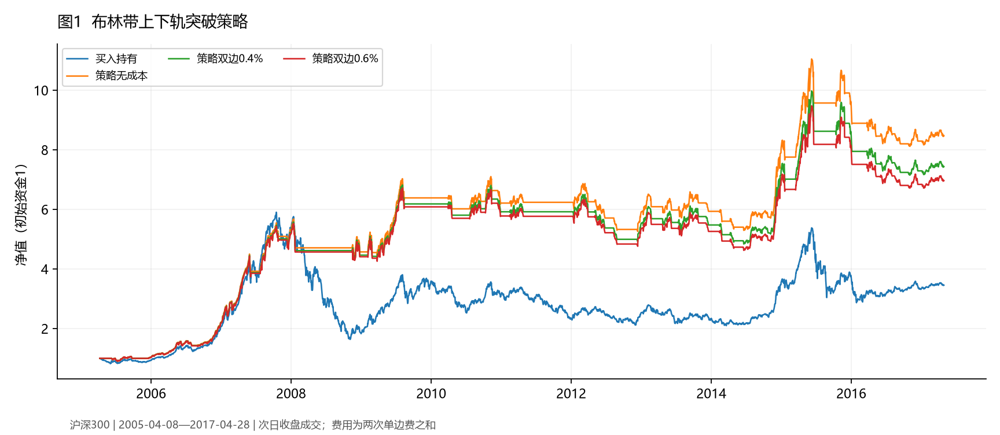

[图1计算数据](data/fig_01.csv)

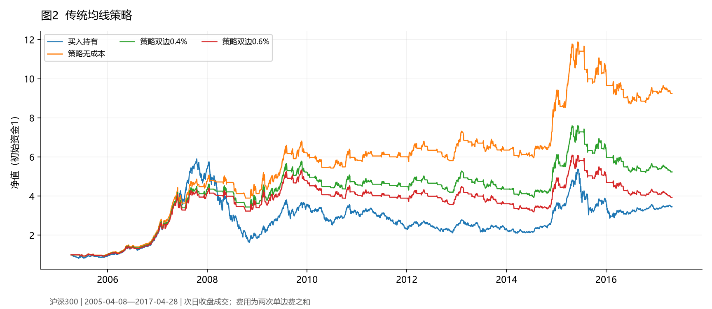

[图2计算数据](data/fig_02.csv)

本地结果：布林带无费年化20.16%，MA20无费年化21.07%。它们是原文研究动机的对照：趋势行情中可能获益，频繁穿越与交易费可能侵蚀收益。不能因为RSRS表现较好，就省略普通技术策略。

### 1.2、阻力支撑相对强度概念及其与市场状态的对应

RSRS改为关注支撑和阻力随时间的相对变化。原文提出：支撑相对较强，可能意味着上涨加速或下跌趋缓；阻力相对较强，可能意味着上涨趋缓或下跌加速。它是一套需要后续验证的解释假说，不能把状态示意图当成预测效果证据。

### 1.3、阻力支撑代理变量的定义选择与相对强度的量化

以每天最低价L和最高价H作为代理变量，在最近N天做带截距回归：H=α+βL+ε。β描述最低价变化一个单位时最高价对应的线性变化幅度。单纯两点比值噪声较大，因此采用滚动窗口。

下面四张图对应原图3—6的教学用途，使用明确标注的合成路径重绘，不使用挑选出的市场片段来“证明”假说。

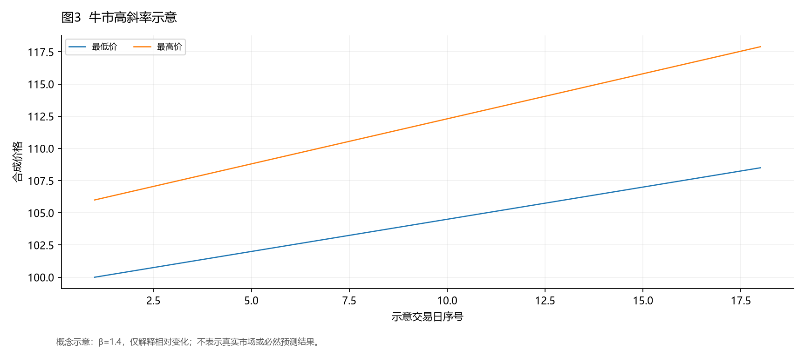

[图3计算数据](data/fig_03.csv)

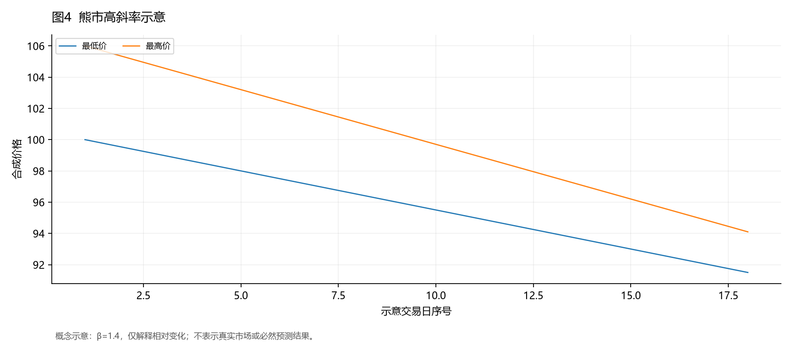

[图4计算数据](data/fig_04.csv)

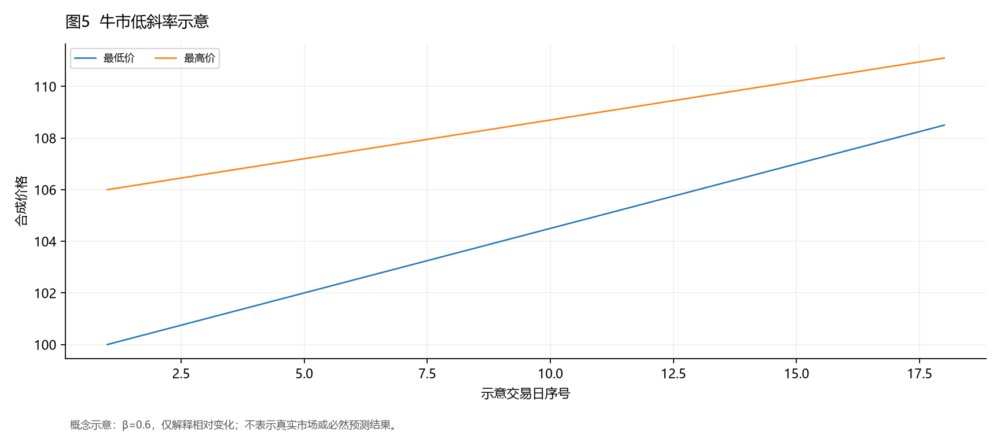

[图5计算数据](data/fig_05.csv)

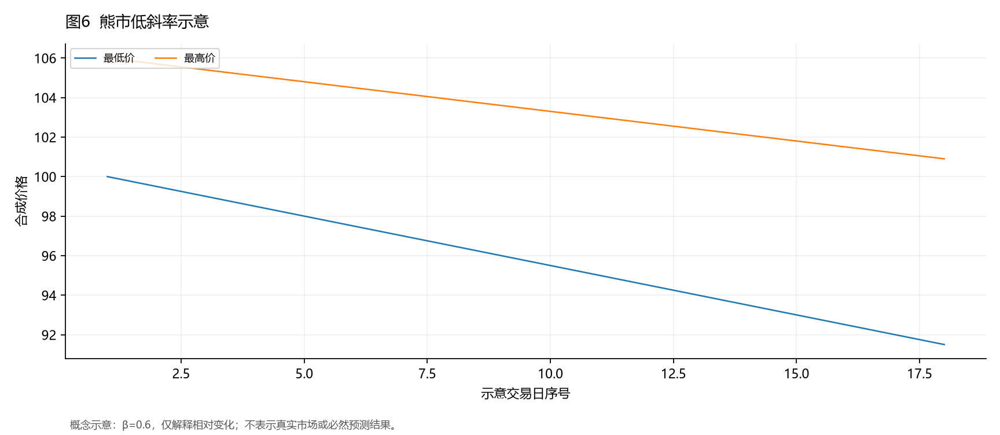

[图6计算数据](data/fig_06.csv)

### 1.4、阻力支撑相对强度（RSRS）指标构建

| 指标 | 定义 | 参数与解释 |
| --- | --- | --- |
| 斜率β | Cov(L,H)/Var(L) | N=18，带截距OLS |
| 标准分z | (β−历史均值)/历史标准差 | M=600，衡量相对历史位置 |

窗口含t日及此前N−1日；标准化包含当期β，使用样本标准差。M不足时使用已有观测，至少10个有效β才计算。这些端点与最低观测数是原文未完全明确的实施约定；不通过调节约定来追平原文业绩。

## 2、RSRS指标择时初步效果

### 2.1、RSRS指标择时策略构建

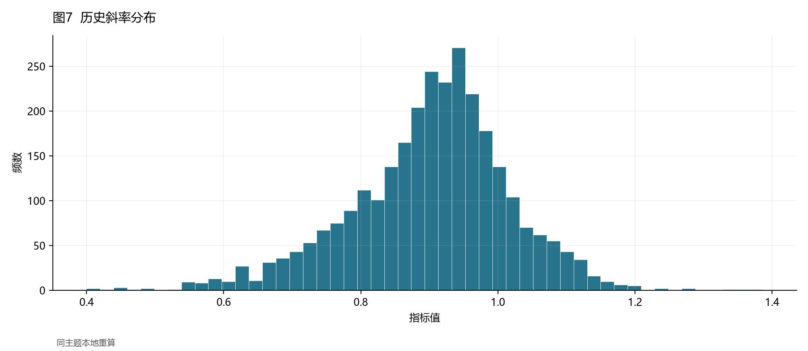

[图7计算数据](data/fig_07.csv)

**表1　斜率低阶矩**

| 指标 | 均值 | 标准差 | 偏度 | 超额峰度 | 样本数 |
| --- | --- | --- | --- | --- | --- |
| 斜率 | 0.902 | 0.116 | -0.466 | 0.987 | 2896 |

[下载表1](tables/table_01.csv)

原文根据斜率历史分布选取买入阈值1.0、卖出阈值0.8。复现固定沿用这两个阈值，没有按本地分布重新拟合最优门槛。观察分布是阈值设计的说明，不是独立的样本外检验。

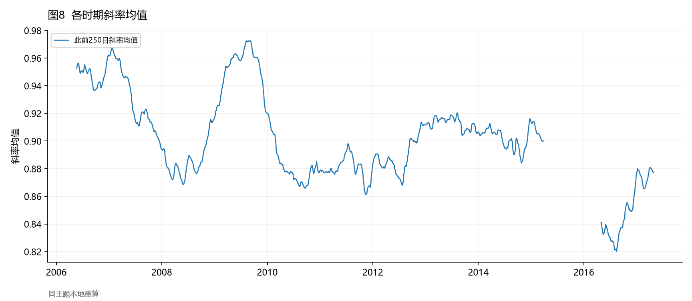

[图8计算数据](data/fig_08.csv)

图8使用前一日以前250个交易日的斜率均值。均值随时期变化，是引入标准分的动机。标准分策略固定N=18、M=600，z>0.7开多，z<−0.7平多，其余持仓不变；等于阈值时也保持原仓。

### 2.2、RSRS指标择时效果

[图9计算数据](data/fig_09.csv)

**表2　斜率与标准分交易统计**

| 统计量 | 斜率 | 标准分 |
| --- | --- | --- |
| 年化收益率 | 23.74% | 21.72% |
| 夏普比率 | 1.17 | 1.14 |
| 最大回撤 | -48.20% | -50.50% |
| 持仓总天数 | 1371.00 | 1306.00 |
| 交易次数 | 45.00 | 49.00 |
| 平均持仓天数 | 30.47 | 26.65 |
| 获利天数 | 770.00 | 727.00 |
| 亏损天数 | 601.00 | 579.00 |
| 胜率（按天） | 56.16% | 55.67% |
| 平均盈利率（按天） | 1.33% | 1.30% |
| 平均亏损率（按天） | -1.25% | -1.20% |
| 平均盈亏比（按天） | 1.06 | 1.08 |
| 盈利次数 | 32.00 | 28.00 |
| 亏损次数 | 13.00 | 21.00 |
| 单次最大盈利 | 76.00% | 73.28% |
| 单次最大亏损 | -17.66% | -17.66% |
| 胜率（按次） | 71.11% | 57.14% |
| 平均盈利率（按次） | 10.53% | 12.55% |
| 平均亏损率（按次） | -3.57% | -3.45% |
| 平均盈亏比（按次） | 2.95 | 3.64 |

[下载表2](tables/table_02.csv)

斜率无费年化23.74%，标准分21.72%，同期买入持有11.25%。表2同时展示按天与按交易段的胜率、盈亏比以及最大单笔损益。应结合收益、回撤和交易质量评价，不能预设标准化必然全面优于斜率。

“年化”是整段复合收益换算，不表示每年收益；“最大回撤”含初始资金1为高水位；胜率仅说明正收益日或交易段占比，不能脱离盈亏幅度判断策略优劣。

**原文讨论的2009—2014年震荡区间**

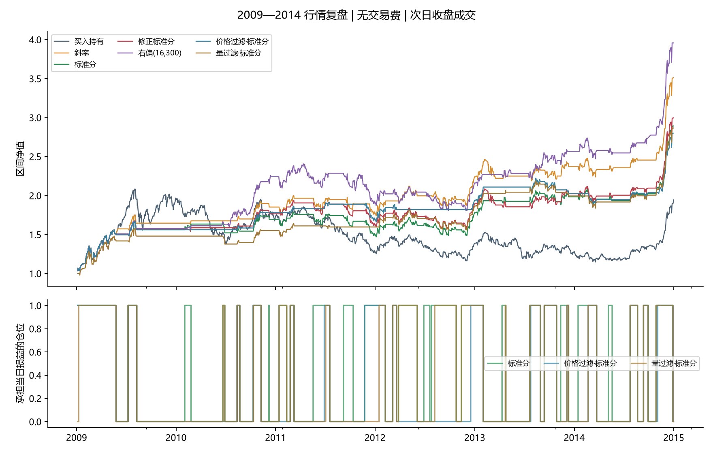

| 年份 | 买入持有 | 斜率 | 标准分 | 修正标准分 | 右偏(16,300) | 价格过滤·标准分 | 量过滤·标准分 |
| --- | --- | --- | --- | --- | --- | --- | --- |
| 2009.000 | 96.71% | 64.56% | 56.16% | 56.68% | 57.73% | 56.16% | 47.96% |
| 2010.000 | -12.51% | 12.56% | 8.48% | 12.74% | 42.14% | 14.08% | 4.89% |
| 2011.000 | -25.01% | -3.30% | -10.66% | -6.87% | -13.95% | -3.91% | 2.87% |
| 2012.000 | 7.55% | 25.02% | 17.50% | 15.14% | 11.96% | 13.29% | 16.78% |
| 2013.000 | -7.65% | 5.95% | 11.53% | 6.83% | 18.78% | 4.48% | 6.97% |
| 2014.000 | 51.66% | 48.04% | 45.82% | 48.07% | 54.26% | 38.22% | 43.70% |

上表按年列出该区间的实际收益，区间净值承接此前已有持仓，并归一到1。不把整体正收益直接描述为每年、每笔都稳定获利；这也不能单独证明收益来自“左侧预测”。

**成本冲击与斜率N敏感性**

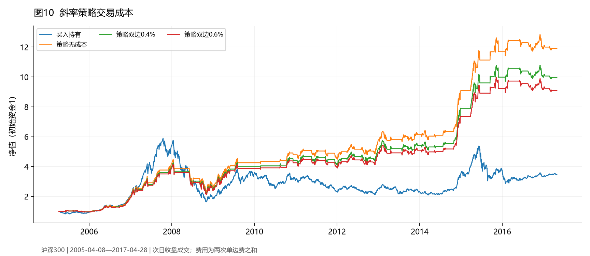

[图10计算数据](data/fig_10.csv)

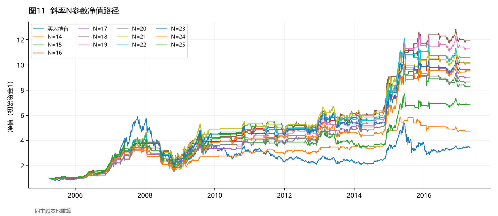

[图11计算数据](data/fig_11.csv)

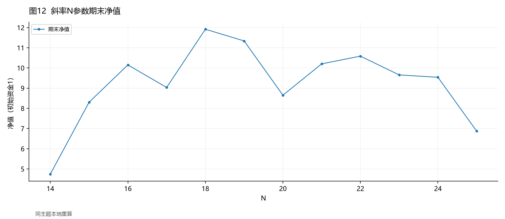

[图12计算数据](data/fig_12.csv)

原图11的图例与图12实际散点为N=14至25，10与26是坐标轴边界。这里完整测试12个整数N，阈值仍为1.0/0.8；每条净值都从相同统计起点计算，没有跳过各自预热时的现金期。

| N | 期末净值 | 年化收益率 | 最大回撤 |
| --- | --- | --- | --- |
| 14.000 | 4.747 | 14.33% | -55.48% |
| 15.000 | 8.304 | 19.96% | -51.54% |
| 16.000 | 10.149 | 22.05% | -51.45% |
| 17.000 | 9.033 | 20.83% | -51.36% |
| 18.000 | 11.915 | 23.74% | -48.20% |
| 19.000 | 11.337 | 23.21% | -48.37% |
| 20.000 | 8.648 | 20.38% | -48.49% |
| 21.000 | 10.200 | 22.10% | -51.26% |
| 22.000 | 10.583 | 22.49% | -54.51% |
| 23.000 | 9.653 | 21.52% | -45.67% |
| 24.000 | 9.537 | 21.40% | -54.68% |
| 25.000 | 6.870 | 18.02% | -56.54% |

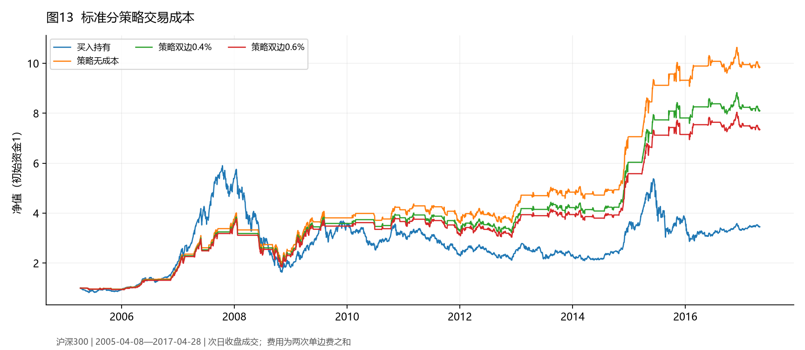

[图13计算数据](data/fig_13.csv)

成本按每次仓位变化扣单边费用，反手扣两份。图中“净值”一律含本金1，累计收益另列，不沿用原文部分段落把净值与累计收益混写的数值表述。

### 2.3、RSRS标准分指标优化

**先检查2008年熊市中的错误开仓问题**

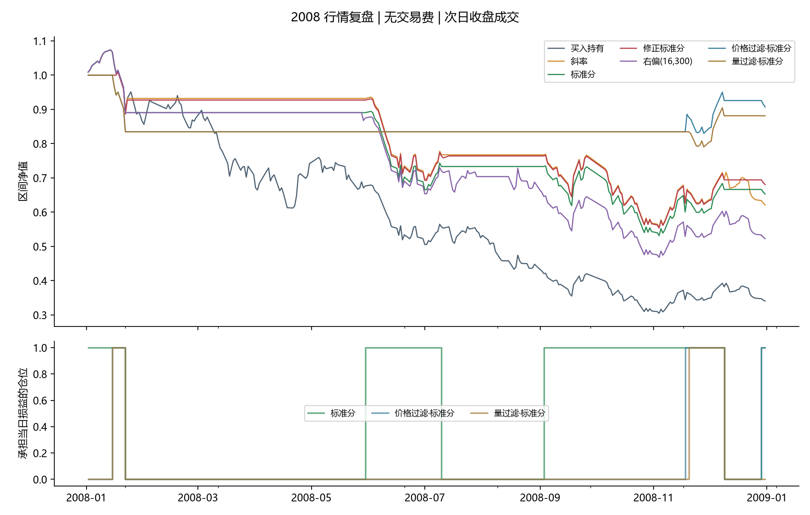

以下列出全部与2008年相交的标准分持仓段。建仓日是实际成交日，信号来自前一交易日；当段毛收益是整个持仓段的收益，跨年段不等同于2008年内收益。

| 建仓日 | 平仓日 | 估值日 | 方向 | 已平仓 | 持仓收益天数 | 当段毛收益 | 开仓信号标准分 | 开仓信号斜率 | 开仓信号R² |
| --- | --- | --- | --- | --- | --- | --- | --- | --- | --- |
| 2007-12-04 00:00:00 | 2008-01-22 00:00:00 | 2008-01-22 00:00:00 | 多头 | True | 33 | -1.56% | 0.753 | 1.012 | 0.895 |
| 2008-05-30 00:00:00 | 2008-07-10 00:00:00 | 2008-07-10 00:00:00 | 多头 | True | 28 | -17.66% | 0.823 | 1.008 | 0.867 |
| 2008-09-03 00:00:00 | 2008-12-09 00:00:00 | 2008-12-09 00:00:00 | 多头 | True | 63 | -9.13% | 1.764 | 1.102 | 0.800 |
| 2008-12-29 00:00:00 | 2009-05-26 00:00:00 | 2009-05-26 00:00:00 | 多头 | True | 97 | 46.64% | 1.111 | 1.029 | 0.921 |

当信号触发买入但随后指数继续下跌，交易段会出现损失。这是原文提出R²修正与后续过滤的实际问题。表中保留盈利和亏损段，不只挑一笔失败交易讲故事。[完整成交记录](data/execution_trades.csv)与[区间绩效](data/case_period_stats.csv)可核查。

**第一步：用R²修正拟合较差的信号**

修正标准分=z×R²。R²刻画高低价在当前回归窗口内的拟合程度，不能解释为预测成功概率。先看指标分布是否改变，再看这种改变是否提升预测性及策略效果。

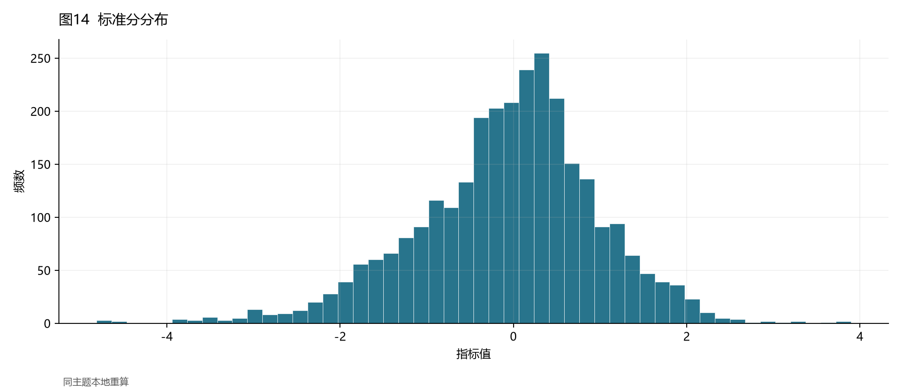

[图14计算数据](data/fig_14.csv)

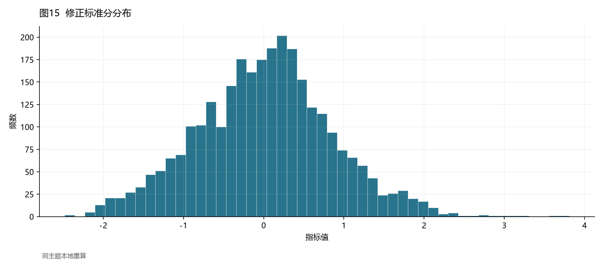

[图15计算数据](data/fig_15.csv)

**表3　标准分与修正标准分分布**

| 指标 | 均值 | 标准差 | 偏度 | 超额峰度 | 样本数 |
| --- | --- | --- | --- | --- | --- |
| 标准分 | -0.063 | 1.054 | -0.478 | 1.097 | 2887 |
| 修正标准分 | 0.013 | 0.848 | 0.120 | 0.273 | 2887 |

[下载表3](tables/table_03.csv)

**第二步：按照原文，研究指标水平与未来10日上涨概率、期望收益的关系**

三种指标统一N=18、M=600。按原报告期指标范围划分50个等宽箱，统计每箱未来10日收盘收益均值及上涨比例，并分左侧、右侧、整体计算“箱中点—条件均值/上涨概率”的相关性。原文未披露精确分箱，本方案参考公开notebook的50箱实现；期末不足10日的标签剔除，不能当作下跌。

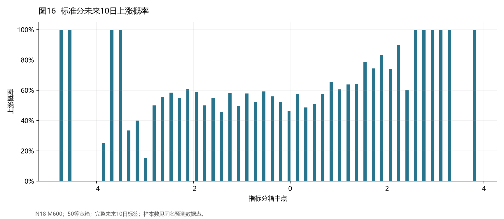

[图16计算数据](data/fig_16.csv)

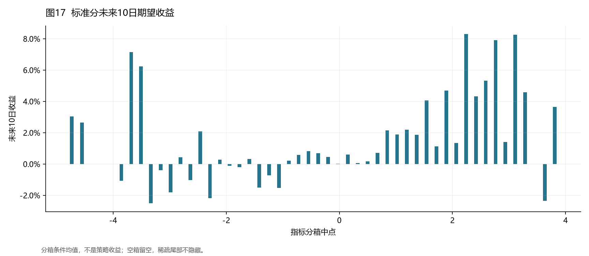

[图17计算数据](data/fig_17.csv)

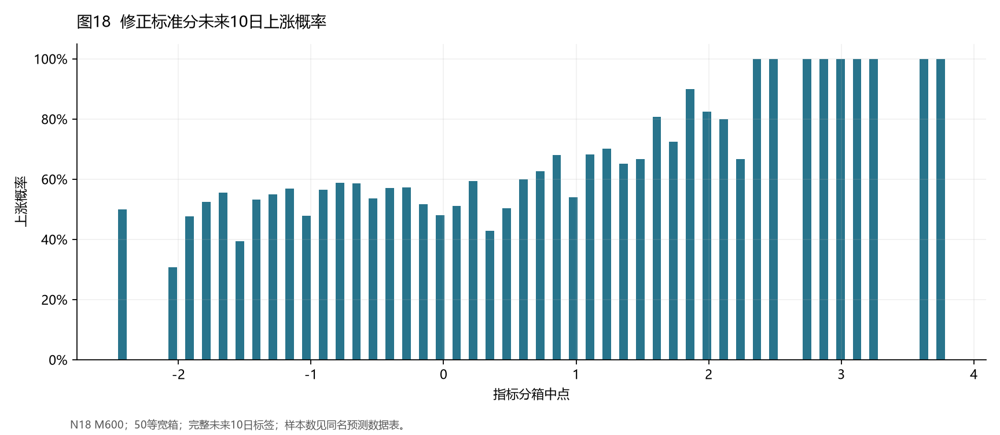

[图18计算数据](data/fig_18.csv)

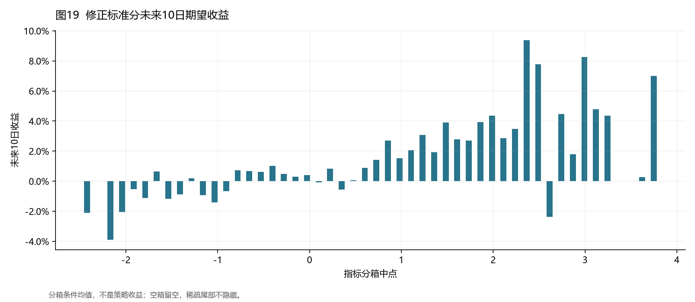

[图19计算数据](data/fig_19.csv)

**第三步：右偏标准分=z×R²×β**

乘以β改变指标两侧的权重与分布。是否实际右偏、左侧预测关系是否改善，需要由下图与相关表判断；名称不构成效果保证。

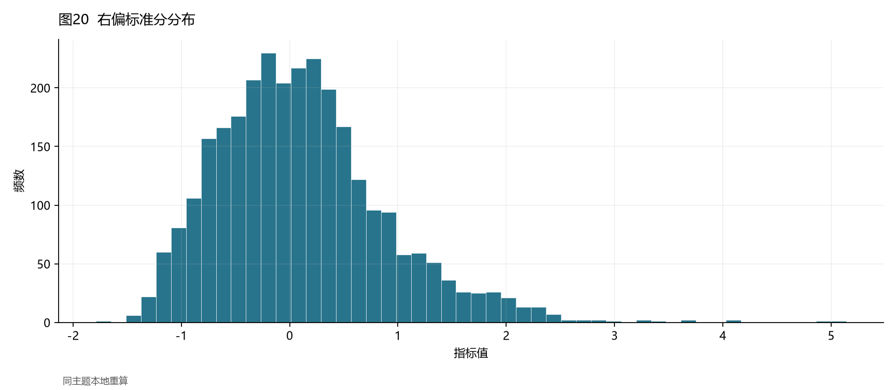

[图20计算数据](data/fig_20.csv)

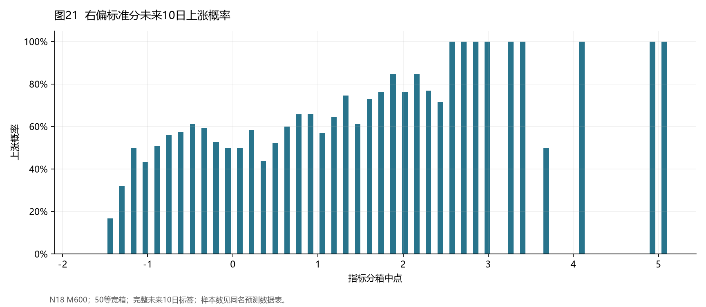

[图21计算数据](data/fig_21.csv)

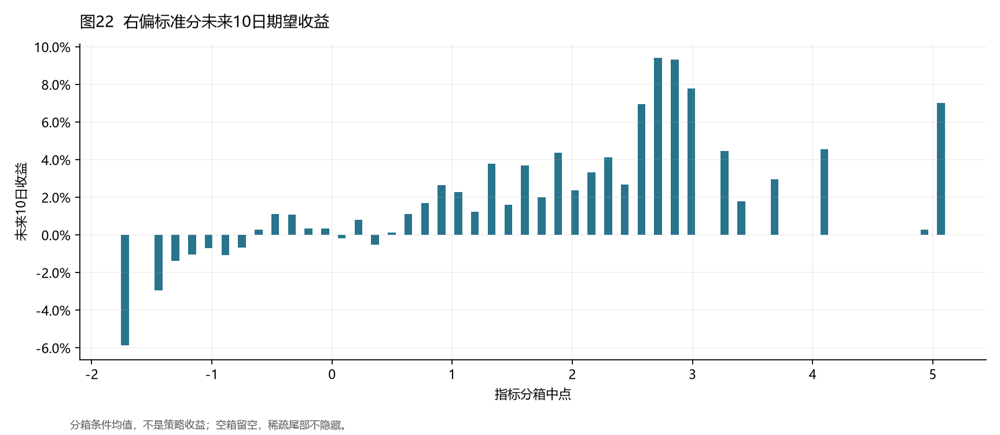

[图22计算数据](data/fig_22.csv)

| 指标 | 侧别 | 非空箱数 | 样本数 | 期望收益相关 | 上涨概率相关 |
| --- | --- | --- | --- | --- | --- |
| 标准分 | 整体 | 46 | 2877 | 0.377 | 0.257 |
| 标准分 | 左侧 | 25 | 1462 | -0.341 | -0.357 |
| 标准分 | 右侧 | 21 | 1415 | 0.403 | 0.379 |
| 修正标准分 | 整体 | 47 | 2877 | 0.750 | 0.722 |
| 修正标准分 | 左侧 | 19 | 1433 | 0.749 | 0.502 |
| 修正标准分 | 右侧 | 28 | 1444 | 0.517 | 0.625 |
| 右偏标准分 | 整体 | 40 | 2877 | 0.740 | 0.849 |
| 右偏标准分 | 左侧 | 12 | 1406 | 0.867 | 0.810 |
| 右偏标准分 | 右侧 | 28 | 1471 | 0.509 | 0.769 |

**结果解读：**按本方案，整体期望收益相关性从标准分的0.377，变为修正标准分的0.750和右偏的0.740。左侧标准分为负相关，修正后转为正相关，支持原文关于改善左侧预测关系的方向；但右偏整体收益相关并未超过修正标准分，不能复述“右偏在所有维度最优”。

这组相关性是分箱后汇总关系，不是逐日IC，也不是策略收益。尾部箱可能只有少数观测，10日收益区间又彼此重叠，故不据此声称统计显著或未来必然有效。每箱样本数与30/50/70箱敏感性均保存：[箱数敏感性](data/prediction_bin_sensitivity.csv)。这项补充仅解释原文未披露分箱带来的不确定性。

**将三种标准分转换成交易策略**

标准分和修正标准分仍为18/600；基础右偏策略按原文改用16/300，阈值仍±0.7。指标预测性比较与策略比较参数不同，应明确区分，不能把全部收益变化归因于乘β。

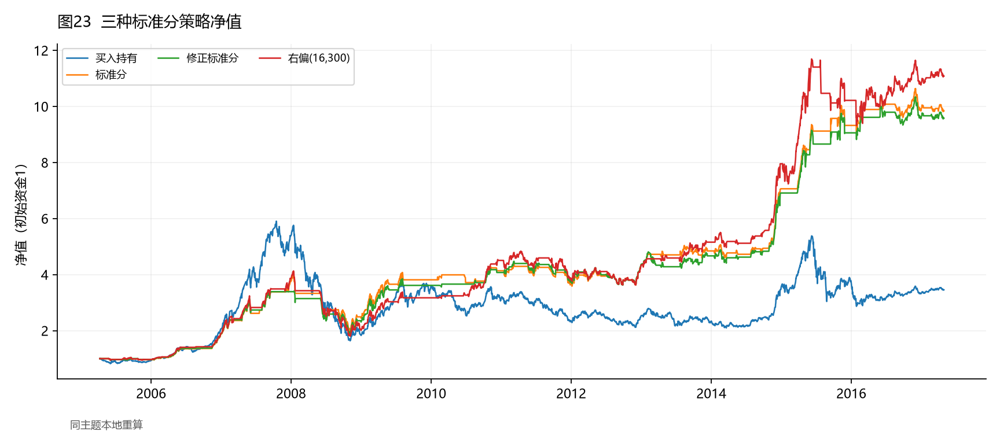

[图23计算数据](data/fig_23.csv)

**表4　三种标准分交易统计**

| 统计量 | 标准分 | 修正标准分 | 右偏(16,300) |
| --- | --- | --- | --- |
| 年化收益率 | 21.72% | 21.44% | 22.97% |
| 夏普比率 | 1.14 | 1.13 | 1.07 |
| 最大回撤 | -50.50% | -45.12% | -56.40% |
| 持仓总天数 | 1306.00 | 1311.00 | 1733.00 |
| 交易次数 | 49.00 | 44.00 | 37.00 |
| 平均持仓天数 | 26.65 | 29.80 | 46.84 |
| 获利天数 | 727.00 | 728.00 | 967.00 |
| 亏损天数 | 579.00 | 583.00 | 766.00 |
| 胜率（按天） | 55.67% | 55.53% | 55.80% |
| 平均盈利率（按天） | 1.30% | 1.29% | 1.24% |
| 平均亏损率（按天） | -1.20% | -1.19% | -1.22% |
| 平均盈亏比（按天） | 1.08 | 1.09 | 1.02 |
| 盈利次数 | 28.00 | 26.00 | 27.00 |
| 亏损次数 | 21.00 | 18.00 | 10.00 |
| 单次最大盈利 | 73.28% | 73.28% | 70.46% |
| 单次最大亏损 | -17.66% | -17.60% | -20.96% |
| 胜率（按次） | 57.14% | 59.09% | 72.97% |
| 平均盈利率（按次） | 12.55% | 13.11% | 13.19% |
| 平均亏损率（按次） | -3.45% | -3.67% | -6.32% |
| 平均盈亏比（按次） | 3.64 | 3.57 | 2.09 |

[下载表4](tables/table_04.csv)

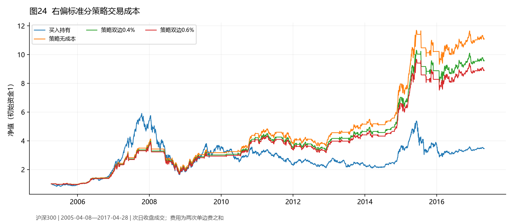

[图24计算数据](data/fig_24.csv)

本地基础右偏无费年化22.97%，最大回撤-56.40%。分布修正并没有自动解决大幅回撤，这正是进入原文第3章、检查开仓过滤的原因。

## 3、RSRS指标配合量价数据优化策略

本章“优化”均指研报本身的量价过滤方案。研究不增加新的择时因子，也不按本地最优结果替换原文规则。三种指标的过滤版本统一N=18、M=600、阈值±0.7。

### 3.1、基于当前市场价格趋势的优化

开多同时要求指标>0.7且MA20(t−1)>MA20(t−3)；指标<−0.7时无条件平多。可做空时，开空还要求MA20(t−1)<MA20(t−3)，指标>0.7时无条件平空。这里遵从原文逐条规则；原文解释段“当日与3日前”的措辞不同，记录为歧义。

[图25计算数据](data/fig_25.csv)

**表5　价格过滤交易统计**

| 统计量 | 价格过滤·标准分 | 价格过滤·修正 | 价格过滤·右偏 |
| --- | --- | --- | --- |
| 年化收益率 | 22.62% | 24.30% | 22.23% |
| 夏普比率 | 1.46 | 1.55 | 1.36 |
| 最大回撤 | -17.00% | -15.76% | -16.55% |
| 持仓总天数 | 852.00 | 885.00 | 942.00 |
| 交易次数 | 31.00 | 28.00 | 25.00 |
| 平均持仓天数 | 27.48 | 31.61 | 37.68 |
| 获利天数 | 500.00 | 525.00 | 555.00 |
| 亏损天数 | 352.00 | 360.00 | 387.00 |
| 胜率（按天） | 58.69% | 59.32% | 58.92% |
| 平均盈利率（按天） | 1.30% | 1.27% | 1.27% |
| 平均亏损率（按天） | -1.13% | -1.11% | -1.18% |
| 平均盈亏比（按天） | 1.15 | 1.14 | 1.08 |
| 盈利次数 | 21.00 | 21.00 | 19.00 |
| 亏损次数 | 10.00 | 7.00 | 6.00 |
| 单次最大盈利 | 73.28% | 73.28% | 76.74% |
| 单次最大亏损 | -16.55% | -7.28% | -12.66% |
| 胜率（按次） | 67.74% | 75.00% | 76.00% |
| 平均盈利率（按次） | 15.38% | 14.98% | 15.77% |
| 平均亏损率（按次） | -3.96% | -2.50% | -3.28% |
| 平均盈亏比（按次） | 3.89 | 5.98 | 4.81 |

[下载表5](tables/table_05.csv)

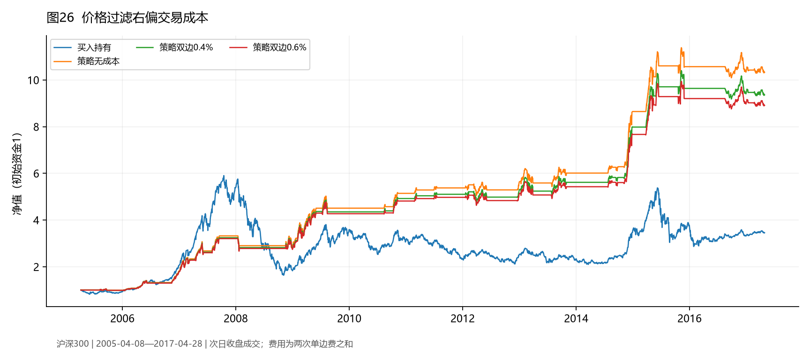

[图26计算数据](data/fig_26.csv)

价格过滤右偏无费年化22.23%，最大回撤-16.55%。六种过滤组合的排序由实际表格决定，不强行重复原文“右偏收益最高”的判断。过滤也减少市场参与，回撤变化不能全部解释为预测更准确。

### 3.2、基于RSRS指标与交易量相关性的优化

开仓要求前10日成交量与修正标准分的相关系数>0。三种信号都使用修正标准分作为量相关对象，窗口固定t−10至t−1；平仓只依据信号阈值，不要求相关性继续为正。原文第3.2节与总结表的简称不完全一致，此处以详细交易规则为准。

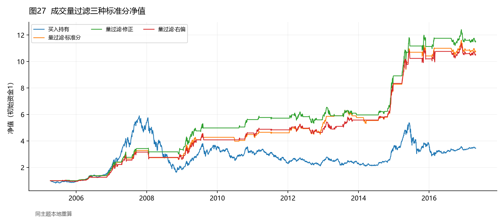

[图27计算数据](data/fig_27.csv)

**表6　成交量过滤交易统计**

| 统计量 | 量过滤·标准分 | 量过滤·修正 | 量过滤·右偏 |
| --- | --- | --- | --- |
| 年化收益率 | 22.64% | 23.36% | 22.41% |
| 夏普比率 | 1.42 | 1.49 | 1.32 |
| 最大回撤 | -20.97% | -15.76% | -17.85% |
| 持仓总天数 | 972.00 | 952.00 | 1059.00 |
| 交易次数 | 39.00 | 33.00 | 30.00 |
| 平均持仓天数 | 24.92 | 28.85 | 35.30 |
| 获利天数 | 561.00 | 555.00 | 617.00 |
| 亏损天数 | 411.00 | 397.00 | 442.00 |
| 胜率（按天） | 57.72% | 58.30% | 58.26% |
| 平均盈利率（按天） | 1.25% | 1.24% | 1.24% |
| 平均亏损率（按天） | -1.09% | -1.08% | -1.17% |
| 平均盈亏比（按天） | 1.14 | 1.14 | 1.06 |
| 盈利次数 | 26.00 | 22.00 | 21.00 |
| 亏损次数 | 13.00 | 11.00 | 9.00 |
| 单次最大盈利 | 73.28% | 73.28% | 76.74% |
| 单次最大亏损 | -16.55% | -7.28% | -12.66% |
| 胜率（按次） | 66.67% | 66.67% | 70.00% |
| 平均盈利率（按次） | 12.95% | 14.25% | 14.74% |
| 平均亏损率（按次） | -3.99% | -2.35% | -3.19% |
| 平均盈亏比（按次） | 3.24 | 6.06 | 4.63 |

[下载表6](tables/table_06.csv)

**按原文扫描标准化窗口M**

**表7　标准分M参数敏感性**

| M | 单指标净值 | 价格优化净值 | 相关性优化净值 |
| --- | --- | --- | --- |
| 450.000 | 8.372 | 9.183 | 10.932 |
| 500.000 | 9.137 | 11.679 | 13.301 |
| 550.000 | 8.801 | 9.833 | 10.768 |
| 600.000 | 9.841 | 10.714 | 10.740 |
| 650.000 | 9.806 | 10.318 | 10.732 |
| 700.000 | 10.280 | 10.808 | 10.675 |
| 750.000 | 10.065 | 11.073 | 10.729 |
| 800.000 | 9.628 | 10.663 | 10.567 |

[下载表7](tables/table_07.csv)

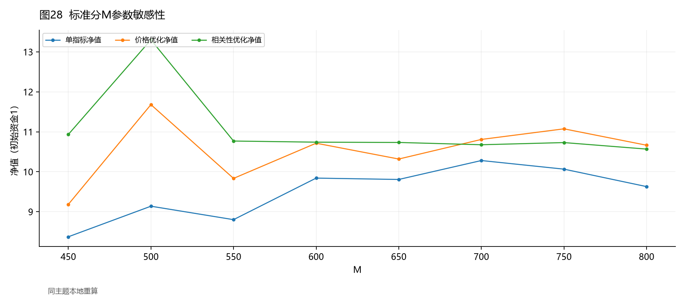

[图28计算数据](data/fig_28.csv)

固定N=18、阈值±0.7，在450、500、550、600、650、700、750、800上比较单指标、价格过滤、量相关过滤。表7没有明确写出指标变体，本研究依据其M=600单指标列与前文标准分结果的对应关系，将三列解释为标准分族，明确标注这一推断；没有把三个指标净值取平均，也没有把量过滤写成价格过滤。

M不足时允许扩展预热，至少10个有效β；M变化时不重选阈值、不裁去现金期。观察到的最优点只描述这段样本，不用于回填主参数或声称存在普遍最优M。

本地表7并未重现“M超过600后净值基本单调递减”的完整形态。应把这个差异作为复现结果，而不是扩大搜索范围寻找一组能匹配原文的参数。

### 3.3、标准分优化策略在多空及其它市场上的实证效果

主文按原文展示：沪深300价格过滤右偏多空，以及上证50、中证500的价格过滤右偏多头。四列统一截至2017-03-31，避免把4月多头与3月多空无说明地混在一张表；这是对原文月份描述的统一实施。

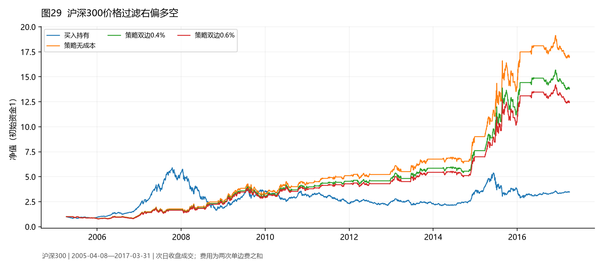

[图29计算数据](data/fig_29.csv)

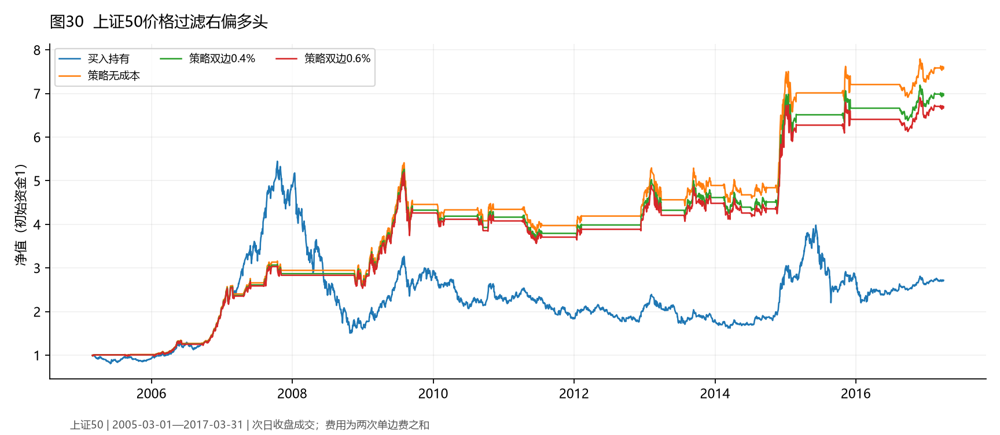

[图30计算数据](data/fig_30.csv)

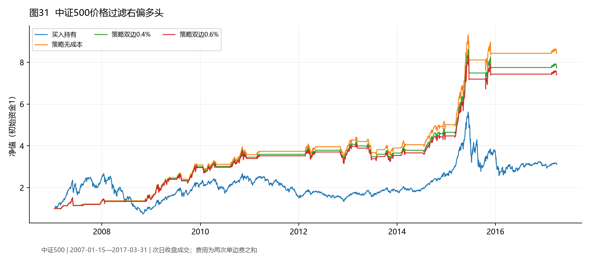

[图31计算数据](data/fig_31.csv)

**表8　多空与跨市场交易统计**

| 统计量 | 沪深300多头 | 沪深300多空 | 上证50多头 | 中证500多头 |
| --- | --- | --- | --- | --- |
| 年化收益率 | 22.43% | 27.79% | 18.98% | 24.18% |
| 夏普比率 | 1.37 | 1.14 | 1.09 | 1.25 |
| 最大回撤 | -16.55% | -27.49% | -29.70% | -25.44% |
| 持仓总天数 | 924.00 | 1907.00 | 1172.00 | 895.00 |
| 交易次数 | 25.00 | 52.00 | 22.00 | 22.00 |
| 平均持仓天数 | 36.96 | 36.67 | 53.27 | 40.68 |
| 获利天数 | 545.00 | 1021.00 | 633.00 | 562.00 |
| 亏损天数 | 379.00 | 886.00 | 539.00 | 333.00 |
| 胜率（按天） | 58.98% | 53.54% | 54.01% | 62.79% |
| 平均盈利率（按天） | 1.29% | 1.37% | 1.29% | 1.36% |
| 平均亏损率（按天） | -1.20% | -1.23% | -1.11% | -1.61% |
| 平均盈亏比（按天） | 1.08 | 1.12 | 1.17 | 0.85 |
| 盈利次数 | 19.00 | 34.00 | 16.00 | 19.00 |
| 亏损次数 | 6.00 | 18.00 | 6.00 | 3.00 |
| 单次最大盈利 | 76.74% | 76.74% | 89.41% | 80.41% |
| 单次最大亏损 | -12.66% | -16.60% | -8.56% | -12.52% |
| 胜率（按次） | 76.00% | 65.38% | 72.73% | 86.36% |
| 平均盈利率（按次） | 15.77% | 13.58% | 17.57% | 14.47% |
| 平均亏损率（按次） | -3.20% | -6.12% | -4.70% | -5.52% |
| 平均盈亏比（按次） | 4.93 | 2.22 | 3.74 | 2.62 |

[下载表8](tables/table_08.csv)

| 市场版本 | 单边成本 | 实际起点 | 实际终点 | 年化收益率 | 最大回撤 | 期末净值 |
| --- | --- | --- | --- | --- | --- | --- |
| 沪深300多头 | 0.00% | 2005-04-08 | 2017-03-31 | 22.43% | -16.55% | 10.377 |
| 沪深300多头 | 0.20% | 2005-04-08 | 2017-03-31 | 21.40% | -16.71% | 9.405 |
| 沪深300多头 | 0.30% | 2005-04-08 | 2017-03-31 | 20.88% | -16.80% | 8.953 |
| 沪深300多空 | 0.00% | 2005-04-08 | 2017-03-31 | 27.79% | -27.49% | 17.023 |
| 沪深300多空 | 0.20% | 2005-04-08 | 2017-03-31 | 25.52% | -27.86% | 13.840 |
| 沪深300多空 | 0.30% | 2005-04-08 | 2017-03-31 | 24.40% | -28.16% | 12.476 |
| 上证50多头 | 0.00% | 2005-03-01 | 2017-03-31 | 18.98% | -29.70% | 7.600 |
| 上证50多头 | 0.20% | 2005-03-01 | 2017-03-31 | 18.12% | -30.82% | 6.986 |
| 上证50多头 | 0.30% | 2005-03-01 | 2017-03-31 | 17.70% | -31.38% | 6.698 |
| 中证500多头 | 0.00% | 2007-01-15 | 2017-03-31 | 24.18% | -25.44% | 8.454 |
| 中证500多头 | 0.20% | 2007-01-15 | 2017-03-31 | 23.10% | -25.44% | 7.758 |
| 中证500多头 | 0.30% | 2007-01-15 | 2017-03-31 | 22.57% | -25.44% | 7.431 |

截至3月底，沪深300价格过滤右偏多头年化22.43%，多空27.79%；对应最大回撤为-16.55%和-27.49%。收益提高伴随更深回撤，不能只看净值判断多空更好。跨市场图同时保留买入持有与两档成本，可以判断原文规则是否在其他指数上仍有历史表现。

多空使用−1/0/+1的日度指数暴露，主表空头持有费为0，没有融券可得性、股息补偿、基差、保证金或展期限制。因此它是原文信号规则的指数模拟，不能直接视为可交易产品的实盘收益。中证500缺失2005—2006年，跨市场收益不能当成完全同期间排名。

## 4、结论

**表9　十种策略规则汇总**

| 策略 | 指标 | N/M | 开/平阈值 | 开仓过滤 |
| --- | --- | --- | --- | --- |
| 斜率 | β | 18/不适用 | 1.0/0.8 | 无 |
| 标准分 | z | 18/600 | 0.7/−0.7 | 无 |
| 修正标准分 | z×R² | 18/600 | 0.7/−0.7 | 无 |
| 右偏(16,300) | z×R²×β | 16/300 | 0.7/−0.7 | 无 |
| 价格过滤·标准分 | z | 18/600 | 0.7/−0.7 | MA20(t−1)>MA20(t−3) |
| 量过滤·标准分 | z | 18/600 | 0.7/−0.7 | corr(前10日量,修正标准分)>0 |
| 价格过滤·修正 | z×R² | 18/600 | 0.7/−0.7 | MA20(t−1)>MA20(t−3) |
| 量过滤·修正 | z×R² | 18/600 | 0.7/−0.7 | corr(前10日量,修正标准分)>0 |
| 价格过滤·右偏 | z×R²×β | 18/600 | 0.7/−0.7 | MA20(t−1)>MA20(t−3) |
| 量过滤·右偏 | z×R²×β | 18/600 | 0.7/−0.7 | corr(前10日量,修正标准分)>0 |

[下载表9](tables/table_09.csv)

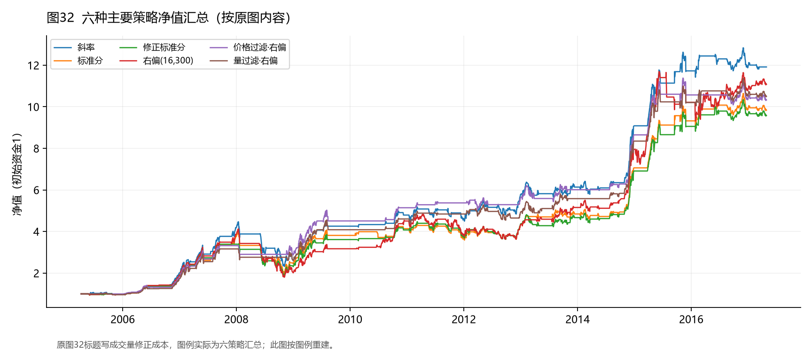

[图32计算数据](data/fig_32.csv)

**表10　六种主要策略绩效汇总**

| 统计量 | 斜率 | 标准分 | 修正标准分 | 右偏(16,300) | 价格过滤·右偏 | 量过滤·右偏 |
| --- | --- | --- | --- | --- | --- | --- |
| 年化收益率 | 23.74% | 21.72% | 21.44% | 22.97% | 22.23% | 22.41% |
| 夏普比率 | 1.17 | 1.14 | 1.13 | 1.07 | 1.36 | 1.32 |
| 最大回撤 | -48.20% | -50.50% | -45.12% | -56.40% | -16.55% | -17.85% |
| 胜率（按次） | 71.11% | 57.14% | 59.09% | 72.97% | 76.00% | 70.00% |
| 平均盈亏比（按次） | 2.95 | 3.64 | 3.57 | 2.09 | 4.81 | 4.63 |

[下载表10](tables/table_10.csv)

**图32的原文差异：**标题写“交易量相关性优化修正标准分的成本”，但实际图例是六种策略净值汇总。本图依实际图例和紧邻表10重建；标题所指策略的费用结果另外保存于[成交量过滤修正成本表](data/volume_modified_costs.csv)，不把两个对象混为一谈。

**本地复现的结论：**基础斜率、标准分、修正标准分与右偏的无费年化分别为23.74%、21.72%、21.44%、22.97%。价格过滤右偏与量过滤右偏分别为22.23%和22.41%。这些结果支持对原报告期历史收益与过滤效果作有条件评价；具体排序、回撤与参数表现以本地表格为准，不能以“复现”名义预设原结论全部成立。

指标水平与未来收益的分箱关系是描述性证据；策略绩效是在已知历史区间与实施约定下的计算结果。数据缺口、单一数据源、异常行情处理、原文未公开的交易细节和分箱方案，都限制数值对齐及结论强度。

## 附录：实施口径、核查与图表覆盖

**数据与账本：**公开腾讯指数OHLCV，价格指数不含股息。2015-03-27异常高低价屏蔽但日期与收盘收益保留，收盘价尚未独立外部核验。先计算可用全历史，再切片统计；区间开始已有仓位承接，期末不强平。具体数据SHA256、参数与时间戳见[metadata.json](metadata.json)。

**交易统计：**主表按连续同向“损益持仓段”统计，含期末未平仓的估值段；左边界已有仓位形成结转段，不称新增建仓。按天胜率分母是全部持仓日，按次分母是全部交易段，零收益计入分母，平均盈利/亏损分别只对正/负收益取均值。盈亏比是倍数，不带百分号；无相应观测时显示空值。[全指标表](data/all_stats.csv)单列零收益与边界状态，[真实成交账本](data/execution_trades.csv)提供成交日与平仓状态。

**计算可靠性：**全部主结果按独立事件循环核账；截断2017-03-31输入重算信号，核对后续数据不改变历史。见[核账](data/account_checks.csv)、[截断检查](data/prefix_checks.csv)。这些检查验证计算，不替代策略经济有效性检验。

**未能精确复刻的部分：**WIND原始数据及部分早期行情未取得；原文没有完整披露分箱、成交、标准差和最小预热样本约定；表7指标列与图32标题存在上述解释问题。完成同主题实现不等于精确复制原文每个数值。

**完整覆盖清单**

| 类别 | 编号 | 原文内容 | 状态 | 结果文件 | 口径说明 |
| --- | --- | --- | --- | --- | --- |
| 图 | 1 | 布林带上下轨突破策略 | 已重算绘图 | figures/fig_01.png | 同主题本地重算 |
| 图 | 2 | 传统均线策略 | 已重算绘图 | figures/fig_02.png | 同主题本地重算 |
| 图 | 3 | 牛市高斜率示意 | 示意重绘 | figures/fig_03.png | 概念示意，合成路径，不是历史实证 |
| 图 | 4 | 熊市高斜率示意 | 示意重绘 | figures/fig_04.png | 概念示意，合成路径，不是历史实证 |
| 图 | 5 | 牛市低斜率示意 | 示意重绘 | figures/fig_05.png | 概念示意，合成路径，不是历史实证 |
| 图 | 6 | 熊市低斜率示意 | 示意重绘 | figures/fig_06.png | 概念示意，合成路径，不是历史实证 |
| 图 | 7 | 历史斜率分布 | 已重算绘图 | figures/fig_07.png | 同主题本地重算 |
| 图 | 8 | 各时期斜率均值 | 已重算绘图 | figures/fig_08.png | 同主题本地重算 |
| 图 | 9 | 斜率和标准分策略净值 | 已重算绘图 | figures/fig_09.png | 同主题本地重算 |
| 图 | 10 | 斜率策略交易成本 | 已重算绘图 | figures/fig_10.png | 同主题本地重算 |
| 图 | 11 | 斜率N参数净值路径 | 已重算绘图 | figures/fig_11.png | 同主题本地重算 |
| 图 | 12 | 斜率N参数期末净值 | 已重算绘图 | figures/fig_12.png | 同主题本地重算 |
| 图 | 13 | 标准分策略交易成本 | 已重算绘图 | figures/fig_13.png | 同主题本地重算 |
| 图 | 14 | 标准分分布 | 已重算绘图 | figures/fig_14.png | 同主题本地重算 |
| 图 | 15 | 修正标准分分布 | 已重算绘图 | figures/fig_15.png | 同主题本地重算 |
| 图 | 16 | 标准分未来10日上涨概率 | 已重算绘图 | figures/fig_16.png | 50个等宽箱，原文未披露精确分箱 |
| 图 | 17 | 标准分未来10日期望收益 | 已重算绘图 | figures/fig_17.png | 50个等宽箱，原文未披露精确分箱 |
| 图 | 18 | 修正标准分未来10日上涨概率 | 已重算绘图 | figures/fig_18.png | 50个等宽箱，原文未披露精确分箱 |
| 图 | 19 | 修正标准分未来10日期望收益 | 已重算绘图 | figures/fig_19.png | 50个等宽箱，原文未披露精确分箱 |
| 图 | 20 | 右偏标准分分布 | 已重算绘图 | figures/fig_20.png | 同主题本地重算 |
| 图 | 21 | 右偏标准分未来10日上涨概率 | 已重算绘图 | figures/fig_21.png | 50个等宽箱，原文未披露精确分箱 |
| 图 | 22 | 右偏标准分未来10日期望收益 | 已重算绘图 | figures/fig_22.png | 50个等宽箱，原文未披露精确分箱 |
| 图 | 23 | 三种标准分策略净值 | 已重算绘图 | figures/fig_23.png | 同主题本地重算 |
| 图 | 24 | 右偏标准分策略交易成本 | 已重算绘图 | figures/fig_24.png | 同主题本地重算 |
| 图 | 25 | 价格过滤三种标准分净值 | 已重算绘图 | figures/fig_25.png | 同主题本地重算 |
| 图 | 26 | 价格过滤右偏交易成本 | 已重算绘图 | figures/fig_26.png | 同主题本地重算 |
| 图 | 27 | 成交量过滤三种标准分净值 | 已重算绘图 | figures/fig_27.png | 同主题本地重算 |
| 图 | 28 | 标准分M参数敏感性 | 已重算绘图 | figures/fig_28.png | 同主题本地重算 |
| 图 | 29 | 沪深300价格过滤右偏多空 | 已重算绘图 | figures/fig_29.png | 同主题本地重算 |
| 图 | 30 | 上证50价格过滤右偏多头 | 已重算绘图 | figures/fig_30.png | 同主题本地重算 |
| 图 | 31 | 中证500价格过滤右偏多头 | 已重算绘图 | figures/fig_31.png | 同主题本地重算 |
| 图 | 32 | 六种主要策略净值汇总（按原图内容） | 已重算绘图 | figures/fig_32.png | 同主题本地重算 |
| 表 | 1 | 斜率低阶矩 | 已计算 | tables/table_01.csv | 本地数据及明确实施约定；非原文数字复制 |
| 表 | 2 | 斜率与标准分交易统计 | 已计算 | tables/table_02.csv | 本地数据及明确实施约定；非原文数字复制 |
| 表 | 3 | 标准分与修正标准分分布 | 已计算 | tables/table_03.csv | 本地数据及明确实施约定；非原文数字复制 |
| 表 | 4 | 三种标准分交易统计 | 已计算 | tables/table_04.csv | 本地数据及明确实施约定；非原文数字复制 |
| 表 | 5 | 价格过滤交易统计 | 已计算 | tables/table_05.csv | 本地数据及明确实施约定；非原文数字复制 |
| 表 | 6 | 成交量过滤交易统计 | 已计算 | tables/table_06.csv | 本地数据及明确实施约定；非原文数字复制 |
| 表 | 7 | 标准分M参数敏感性 | 已计算 | tables/table_07.csv | 本地数据及明确实施约定；非原文数字复制 |
| 表 | 8 | 多空与跨市场交易统计 | 已计算 | tables/table_08.csv | 本地数据及明确实施约定；非原文数字复制 |
| 表 | 9 | 十种策略规则汇总 | 已计算 | tables/table_09.csv | 本地数据及明确实施约定；非原文数字复制 |
| 表 | 10 | 六种主要策略绩效汇总 | 已计算 | tables/table_10.csv | 本地数据及明确实施约定；非原文数字复制 |

**来源：**原始研报由研究者提供，仅引用章节、图表定位，不在仓库转载PDF。公开实现参考：[QuantsPlaybook RSRS notebook](https://github.com/hugo2046/QuantsPlaybook/blob/master/C-%E6%8B%A9%E6%97%B6%E7%B1%BB/RSRS%E6%8B%A9%E6%97%B6%E6%8C%87%E6%A0%87/py/RSRS.ipynb)。本项目借鉴章节组织与等宽分箱思路，独立实现回测和统计；未复制其输出数字或依赖聚宽账户。

**独立附录：**[延长样本与额外统计检验](../research/report.md)保留统一0.1%单边费用的扩展研究。这些附加检验不替代主文原研报式分箱分析，也不与主文无费绩效表直接混用。
