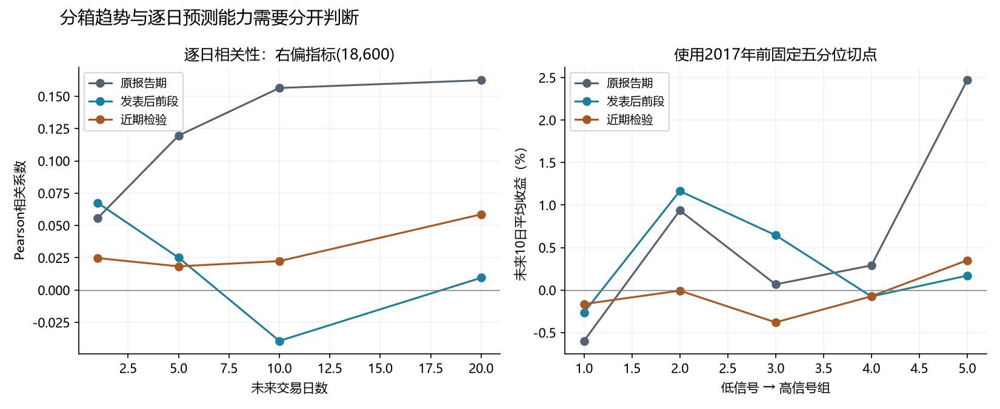
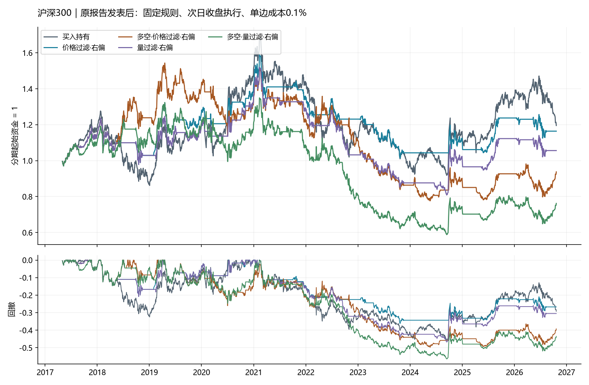
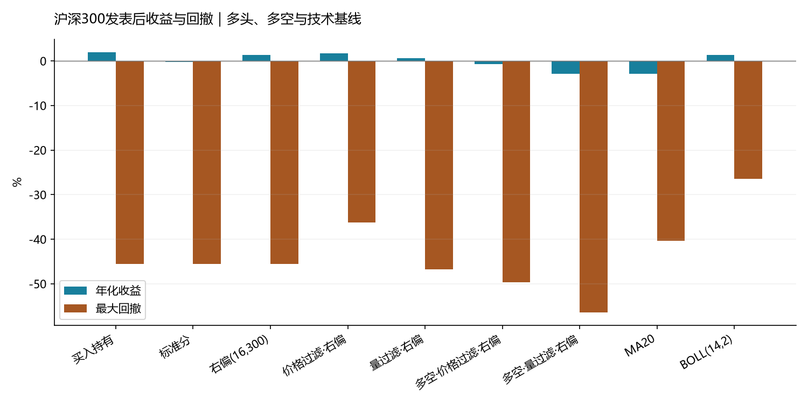

# 独立附录：固定规则延长样本与额外验证

主报告见[按原研报结构复现](../paper/report.md)。本附录固定单边0.1%费用，原期与延长期规则保持一致，不与主文无费表混用。

研究对象：光大证券2017-05-01《基于阻力支撑相对强度（RSRS）的市场择时》。数据截至 **2026-10-21**，为本次更新时最新完整交易日。

## 1. 研究问题与指标逻辑

研究依次检验：高低价相对关系是否包含未来收益信息；研报中的交易规则能否形成扣费后收益；这些固定规则在发表后能否延续。指标预测关系与策略收益分别评价，不以逐项贴合研报数字作为成功标准。

在最近N个交易日上回归 H=α+βL，含截距。β是最高价对最低价的线性敏感度；z=(β−滚动均值)/滚动标准差；修正标准分为z×R²；右偏标准分为z×R²×β。R²是窗口内拟合质量，不能直接解释为未来预测可靠性；名称“右偏”也不保证任意时期的实际分布都右偏。

指标的解释是研究假说：较高指标可能对应更强上行状态，较低指标可能对应下行状态。是否具有可重复预测力，由未来收益检验判断，不能由构造公式直接推出。

## 2. 覆盖范围与固定研究设计

覆盖十个多头/空仓策略、六个按原文过滤式做空规则实现的多空版本、一个同参数右偏对照，以及买入持有、MA20和BOLL(14,2)三个比较基线，共20条规则。价格过滤右偏多空在原文图29、表8有单独绩效展示；其余五个多空组合实现第3.1/3.2节规则，不声称原文逐个披露了对应结果。

完整定义见[研究方案](../../docs/research_protocol.md)、[方法口径](../../docs/methodology.md)和[原文覆盖与实施约定](../../docs/paper_mapping.md)。本研究不评价自行新增的策略改进。

### 开平仓规则

| 版本 | 开多 | 平多 | 开空 | 平空 |
| --- | --- | --- | --- | --- |
| 基础多头 | 指标>上阈值 | 指标<下阈值 | 不适用 | 不适用 |
| 价格过滤多头 | 指标>0.7且MA20(t−1)>MA20(t−3) | 指标<−0.7 | 不适用 | 不适用 |
| 价格过滤多空 | 同上 | 指标<−0.7 | 指标<−0.7且MA20(t−1)<MA20(t−3) | 指标>0.7 |
| 成交量过滤多头 | 指标>0.7且前10日量与修正标准分相关为正 | 指标<−0.7 | 不适用 | 不适用 |
| 成交量过滤多空 | 同上 | 指标<−0.7 | 指标<−0.7且同一相关性为正 | 指标>0.7 |

过滤条件只约束新开仓。中性区、恰好等于阈值或指标缺失时保持已有仓位；过滤数据不可用时禁止新开仓。反向信号先平仓，反向开仓条件也通过时才反手，反手按两次单边换手收费。

斜率策略N=18，阈值1.0/0.8；标准分、修正标准分N=18、M=600、阈值±0.7；基础右偏N=16、M=300。所有量价过滤版本与无过滤同参数右偏对照均N=18、M=600。

### 时间、账户和数据

t日收盘后计算信号，t+1日收盘执行，新仓位只赚取t+1至t+2及之后持有区间的收益。主表单边交易费0.1%，现金收益和无风险利率为0，252交易日年化。原报告期与发表后统一采用这个口径；零交易费结果完整另列metrics_gross.csv。

多头仓位为0/1，多空仓位为−1/0/1。多空结果是按日度有符号指数暴露计算的理想化模拟，主表未计借券、基差、保证金、展期和股息补偿。它不是可直接交易的期货或融券账户业绩。short_carry_sensitivity.csv另列假设空头年费0/2%/5%/10%的敏感性。

OHLCV来自同一公开行情源。异常高低价屏蔽，但保留日期和收盘收益，避免删除交易日后改变时间间隔。三市场2015-03-27的OHLC不一致尚未获得独立来源校正。标准化最少10个有效斜率、包含当期β、ddof=1是固定实施约定，另做敏感性检验。

先在完整历史上计算信号与账户，再分期统计，阶段之间承接仓位与预热，期末不强制平仓。净值图在分期起点归一为1不代表重新入场。预测标签终点必须落在所属分期内。

| 分期 | 计划范围 | 用途 |
| --- | --- | --- |
| 原报告期 | 2005-04-08—2017-04-28 | 发表前可得样本 |
| 发表后前段 | 2017-05-02—2021-12-31 | 第一阶段持续性 |
| 近期检验 | 2022-01-01—2026-10-21 | 后续持续性 |
| 发表后全部 | 2017-05-02—2026-10-21 | 发表后总体效果 |
| 2026年内 | 2026-01-01—2026-10-21 | 年内累计表现 |

分期边界预先按发表时间和日历阶段划分，不按结果挑选。各市场实际可用日期记录在metrics.csv；中证500早期数据较短，不能将不同市场早期表现当作严格同期间比较。原文部分表格的起止时间不同，本研究统一期间，不进行数值强配。

### 一致性与数据审计

180组截断重算全部通过：追加数据没有改变此前的信号、成交仓位、损益仓位和收益。60条完整账户序列通过独立逐日事件核账。20条规则在所有市场和分期保持同一配置标识。

| 市场 | 行数 | 起点 | 终点 | 重复日期 | 价格缺失行 | 非正价格行 | OHLC异常行 | OHLC异常日期 | 负成交量行 |
| --- | --- | --- | --- | --- | --- | --- | --- | --- | --- |
| 沪深300 | 5231 | 2005-04-08 | 2026-10-21 | 0 | 0 | 0 | 1 | 2015-03-27 | 0 |
| 上证50 | 5292 | 2005-01-04 | 2026-10-21 | 0 | 0 | 0 | 1 | 2015-03-27 | 0 |
| 中证500 | 4802 | 2007-01-15 | 2026-10-21 | 0 | 0 | 0 | 1 | 2015-03-27 | 0 |

## 3. 指标有效性检验

三个市场均检验四个同参数(18,600)指标，另列基础右偏(16,300)。预测期限为1/5/10/20个交易日，分别从t和t+1收盘起算。逐日Pearson与Spearman衡量关联；OLS使用HAC标准误处理异方差与序列相关，主设定20阶，10日预测另报10/60阶。

以下展示沪深300未来10日、从t收盘起算的结果。每SD系数为指标增加一个样本标准差对应的收益变化；每个分期对三市场×五指标×四期限×两种标签起点的120个主检验进行Holm校正。HAC区间为单个检验95%区间，未作同时区间校正。

| 分期 | 指标 | 样本数 | Pearson | Spearman | 每SD收益系数 | HAC_t | HAC_p探索 | HAC_p_Holm |
| --- | --- | --- | --- | --- | --- | --- | --- | --- |
| 原报告期 | beta | 2886 | 0.141 | 0.150 | 0.85% | 2.866 | 0.00416 | 0.358 |
| 近期检验 | beta | 1150 | 0.035 | -0.003 | 0.13% | 0.451 | 0.652 | 1 |
| 发表后全部 | beta | 2290 | 0.003 | -0.028 | 0.01% | 0.055 | 0.957 | 1 |
| 原报告期 | zscore | 2877 | 0.121 | 0.111 | 0.73% | 2.531 | 0.0114 | 0.761 |
| 近期检验 | zscore | 1150 | 0.041 | -0.011 | 0.15% | 0.503 | 0.615 | 1 |
| 发表后全部 | zscore | 2290 | 0.006 | -0.027 | 0.02% | 0.122 | 0.903 | 1 |
| 原报告期 | modified | 2877 | 0.147 | 0.118 | 0.89% | 3.122 | 0.0018 | 0.196 |
| 近期检验 | modified | 1150 | 0.026 | -0.014 | 0.09% | 0.322 | 0.748 | 1 |
| 发表后全部 | modified | 2290 | -0.005 | -0.029 | -0.02% | -0.099 | 0.921 | 1 |
| 原报告期 | right_skewed | 2877 | 0.156 | 0.122 | 0.95% | 3.466 | 0.000529 | 0.0614 |
| 近期检验 | right_skewed | 1150 | 0.022 | -0.016 | 0.08% | 0.330 | 0.742 | 1 |
| 发表后全部 | right_skewed | 2290 | -0.011 | -0.031 | -0.04% | -0.220 | 0.826 | 1 |
| 原报告期 | right_skewed_16_300 | 2881 | 0.114 | 0.081 | 0.69% | 2.395 | 0.0166 | 0.948 |
| 近期检验 | right_skewed_16_300 | 1150 | 0.007 | -0.037 | 0.03% | 0.087 | 0.931 | 1 |
| 发表后全部 | right_skewed_16_300 | 2290 | -0.001 | -0.028 | -0.00% | -0.014 | 0.989 | 1 |

### 执行对齐与跨市场

下表用t日右偏(18,600)预测t+1至t+11收盘收益，与次日收盘执行的可获得区间对齐。

| 市场 | 分期 | 样本数 | Pearson | Spearman | HAC_t | HAC_p探索 | HAC_p_Holm |
| --- | --- | --- | --- | --- | --- | --- | --- |
| 沪深300 | 原报告期 | 2876 | 0.150 | 0.119 | 3.378 | 0.000729 | 0.0831 |
| 沪深300 | 近期检验 | 1149 | 0.021 | -0.009 | 0.329 | 0.742 | 1 |
| 沪深300 | 发表后全部 | 2289 | -0.025 | -0.042 | -0.552 | 0.581 | 1 |
| 上证50 | 原报告期 | 2902 | 0.121 | 0.083 | 2.340 | 0.0193 | 0.972 |
| 上证50 | 近期检验 | 1149 | 0.051 | 0.017 | 0.740 | 0.459 | 1 |
| 上证50 | 发表后全部 | 2289 | -0.037 | -0.051 | -0.815 | 0.415 | 1 |
| 中证500 | 原报告期 | 2447 | 0.151 | 0.139 | 2.967 | 0.003 | 0.276 |
| 中证500 | 近期检验 | 1149 | 0.147 | 0.125 | 2.398 | 0.0165 | 1 |
| 中证500 | 发表后全部 | 2289 | 0.060 | 0.027 | 1.150 | 0.25 | 1 |

沪深300右偏(18,600)的10日逐日Pearson由原报告期0.156降至发表后-0.011；执行对齐后发表后为-0.025。原报告期HAC原始p=0.0005291，在本研究120项主检验家族内Holm校正后p=0.061，也未达到5%门槛。这里的证据支持描述性的历史正关联，不能把它夸大为经过所有探索校正后仍稳定显著。

分组图的切点只由2017年前样本确定，并固定用于发表后数据。分箱均值相关是聚合后的描述，不能当作逐日IC或准确率。nonoverlap.csv报告十种起点的非重叠10日窗口，yearly_ic.csv检验逐年关系，distribution.csv报告实际偏度和峰度。

## 4. 原报告期：策略收益与风险

以下统一使用次日收盘成交和单边0.1%费用。平均绝对仓位衡量市场暴露，多空的净仓位接近0并不等于低暴露。

### 多头、基线和同参数对照

| 策略 | 累计收益 | 年化收益 | 夏普 | 最大回撤 | 平均绝对仓位 | 年均单边换手 |
| --- | --- | --- | --- | --- | --- | --- |
| 买入持有 | 245.21% | 11.24% | 0.513 | -72.30% | 99.93% | 0.086 |
| MA20 | 595.85% | 18.15% | 0.960 | -28.96% | 55.54% | 24.418 |
| BOLL(14,2) | 693.47% | 19.49% | 1.062 | -27.42% | 51.48% | 5.589 |
| 斜率 | 988.95% | 22.79% | 1.133 | -48.40% | 46.78% | 7.738 |
| 标准分 | 792.83% | 20.71% | 1.090 | -50.71% | 44.56% | 8.340 |
| 修正标准分 | 777.99% | 20.54% | 1.086 | -45.34% | 44.73% | 7.480 |
| 右偏(16,300) | 929.88% | 22.20% | 1.039 | -56.58% | 59.13% | 6.276 |
| 价格过滤·标准分 | 907.76% | 21.97% | 1.426 | -17.25% | 29.07% | 5.245 |
| 量过滤·标准分 | 894.07% | 21.83% | 1.379 | -21.22% | 33.16% | 6.620 |
| 价格过滤·修正 | 1088.56% | 23.72% | 1.518 | -15.76% | 30.19% | 4.729 |
| 量过滤·修正 | 977.43% | 22.68% | 1.447 | -15.76% | 32.48% | 5.589 |
| 价格过滤·右偏 | 883.26% | 21.72% | 1.331 | -16.63% | 32.14% | 4.213 |
| 量过滤·右偏 | 889.84% | 21.79% | 1.291 | -18.09% | 36.13% | 5.073 |
| 右偏(18,600) | 567.56% | 17.73% | 0.918 | -50.24% | 48.41% | 6.792 |

### 原文规则的多空版本

| 策略 | 累计收益 | 年化收益 | 夏普 | 最大回撤 | 平均绝对仓位 | 年均单边换手 |
| --- | --- | --- | --- | --- | --- | --- |
| 多空·价格过滤·标准分 | 1235.48% | 24.96% | 1.036 | -27.08% | 71.55% | 11.435 |
| 多空·价格过滤·修正 | 1259.41% | 25.15% | 1.034 | -27.63% | 73.76% | 10.575 |
| 多空·价格过滤·右偏 | 1427.74% | 26.42% | 1.096 | -27.63% | 65.68% | 8.856 |
| 多空·量过滤·标准分 | 1042.27% | 23.29% | 0.954 | -26.81% | 79.22% | 13.498 |
| 多空·量过滤·修正 | 1078.00% | 23.62% | 0.964 | -26.95% | 78.61% | 11.779 |
| 多空·量过滤·右偏 | 916.39% | 22.06% | 0.903 | -32.65% | 79.87% | 11.091 |

零交易费的价格过滤右偏对照如下；主结论仍以扣费主表为准。

| 策略 | 累计收益 | 年化收益 | 夏普 | 最大回撤 | 平均绝对仓位 | 年均单边换手 |
| --- | --- | --- | --- | --- | --- | --- |
| 买入持有 | 245.56% | 11.25% | 0.514 | -72.30% | 99.93% | 0.086 |
| 价格过滤·右偏 | 932.78% | 22.23% | 1.359 | -16.55% | 32.14% | 4.213 |
| 多空·价格过滤·右偏 | 1594.24% | 27.55% | 1.133 | -27.49% | 65.68% | 8.856 |

## 5. 固定规则的延长样本效果

从原报告期到以下各期，参数、过滤条件、开平仓逻辑、仓位方向范围、执行时点和费用均不改变。发表后检验为回顾性历史检验，不等同于事前注册的前瞻盲测。

### 发表后全部：多头与基线

| 策略 | 累计收益 | 年化收益 | 夏普 | 最大回撤 | 平均绝对仓位 | 年均单边换手 |
| --- | --- | --- | --- | --- | --- | --- |
| 买入持有 | 19.54% | 1.97% | 0.198 | -45.60% | 100.00% | 0.000 |
| MA20 | -23.03% | -2.83% | -0.154 | -40.35% | 49.96% | 29.583 |
| BOLL(14,2) | 12.77% | 1.33% | 0.166 | -26.44% | 47.48% | 6.683 |
| 斜率 | -6.14% | -0.69% | 0.010 | -43.06% | 41.26% | 6.793 |
| 标准分 | -1.70% | -0.19% | 0.053 | -45.55% | 49.00% | 8.217 |
| 修正标准分 | 12.71% | 1.32% | 0.165 | -46.49% | 47.17% | 6.026 |
| 右偏(16,300) | 12.92% | 1.34% | 0.165 | -45.49% | 55.83% | 5.369 |
| 价格过滤·标准分 | 5.00% | 0.54% | 0.105 | -28.32% | 39.13% | 6.026 |
| 量过滤·标准分 | -5.59% | -0.63% | 0.011 | -40.12% | 39.09% | 6.464 |
| 价格过滤·修正 | 7.01% | 0.74% | 0.122 | -38.19% | 41.43% | 5.150 |
| 量过滤·修正 | 4.55% | 0.49% | 0.102 | -46.81% | 44.39% | 5.588 |
| 价格过滤·右偏 | 16.40% | 1.68% | 0.190 | -36.21% | 48.35% | 4.054 |
| 量过滤·右偏 | 5.61% | 0.60% | 0.113 | -46.75% | 51.91% | 4.492 |
| 右偏(18,600) | 21.96% | 2.20% | 0.223 | -46.43% | 54.30% | 4.930 |

### 发表后全部：多空

| 策略 | 累计收益 | 年化收益 | 夏普 | 最大回撤 | 平均绝对仓位 | 年均单边换手 |
| --- | --- | --- | --- | --- | --- | --- |
| 多空·价格过滤·标准分 | -3.39% | -0.38% | 0.061 | -41.42% | 80.48% | 12.710 |
| 多空·价格过滤·修正 | -12.78% | -1.49% | -0.006 | -51.90% | 81.83% | 10.080 |
| 多空·价格过滤·右偏 | -6.25% | -0.71% | 0.043 | -49.68% | 80.61% | 7.889 |
| 多空·量过滤·标准分 | -27.94% | -3.53% | -0.117 | -55.81% | 80.87% | 13.148 |
| 多空·量过滤·修正 | -20.80% | -2.52% | -0.049 | -58.32% | 91.65% | 10.737 |
| 多空·量过滤·右偏 | -23.79% | -2.93% | -0.078 | -56.38% | 88.96% | 8.546 |

### 发表后前段

| 策略 | 累计收益 | 年化收益 | 夏普 | 最大回撤 | 平均绝对仓位 | 年均单边换手 |
| --- | --- | --- | --- | --- | --- | --- |
| 买入持有 | 43.63% | 8.33% | 0.506 | -32.46% | 100.00% | 0.000 |
| MA20 | -16.80% | -3.98% | -0.225 | -32.14% | 55.88% | 29.621 |
| BOLL(14,2) | -7.37% | -1.68% | -0.051 | -26.44% | 54.47% | 7.516 |
| 价格过滤·右偏 | 35.50% | 6.95% | 0.527 | -20.82% | 54.39% | 4.863 |
| 多空·价格过滤·右偏 | 22.88% | 4.66% | 0.345 | -26.04% | 84.65% | 8.842 |
| 量过滤·右偏 | 29.01% | 5.79% | 0.453 | -20.82% | 54.21% | 4.863 |
| 多空·量过滤·右偏 | 8.42% | 1.80% | 0.189 | -24.79% | 87.19% | 9.726 |

### 近期检验

| 策略 | 累计收益 | 年化收益 | 夏普 | 最大回撤 | 平均绝对仓位 | 年均单边换手 |
| --- | --- | --- | --- | --- | --- | --- |
| 买入持有 | -16.77% | -3.91% | -0.131 | -36.05% | 100.00% | 0.000 |
| MA20 | -7.50% | -1.68% | -0.076 | -22.93% | 44.14% | 29.545 |
| BOLL(14,2) | 21.73% | 4.36% | 0.403 | -16.98% | 40.60% | 5.866 |
| 价格过滤·右偏 | -14.10% | -3.25% | -0.208 | -25.22% | 42.41% | 3.259 |
| 多空·价格过滤·右偏 | -23.71% | -5.71% | -0.288 | -42.83% | 76.64% | 6.952 |
| 量过滤·右偏 | -18.14% | -4.25% | -0.260 | -37.29% | 49.66% | 4.128 |
| 多空·量过滤·右偏 | -29.71% | -7.37% | -0.358 | -47.69% | 90.69% | 7.386 |

### 2026年内

| 策略 | 累计收益 | 年化收益 | 夏普 | 最大回撤 | 平均绝对仓位 | 年均单边换手 |
| --- | --- | --- | --- | --- | --- | --- |
| 买入持有 | -11.19% | -14.49% | -0.748 | -18.73% | 100.00% | 0.000 |
| MA20 | -9.38% | -12.18% | -1.052 | -12.92% | 43.46% | 27.707 |
| BOLL(14,2) | -6.31% | -8.24% | -0.653 | -11.73% | 39.79% | 7.916 |
| 价格过滤·右偏 | -5.93% | -7.74% | -0.490 | -10.49% | 43.98% | 5.277 |
| 多空·价格过滤·右偏 | 1.16% | 1.53% | 0.174 | -18.74% | 95.81% | 9.236 |
| 量过滤·右偏 | -5.93% | -7.74% | -0.490 | -10.49% | 43.98% | 5.277 |
| 多空·量过滤·右偏 | -1.41% | -1.85% | -0.008 | -18.74% | 100.00% | 10.555 |

2026年数据尚不是完整年度，应优先阅读累计收益；年化值仅为同一公式的换算。全部20条规则在全部分期的结果见metrics.csv，年度路径见yearly.csv。

### 发表后跨市场结果

| 市场 | 策略 | 年化收益 | 夏普 | 最大回撤 | 平均净仓位 | 平均绝对仓位 |
| --- | --- | --- | --- | --- | --- | --- |
| 沪深300 | 买入持有 | 1.97% | 0.198 | -45.60% | 100.00% | 100.00% |
| 沪深300 | 价格过滤·右偏 | 1.68% | 0.190 | -36.21% | 48.35% | 48.35% |
| 沪深300 | 量过滤·右偏 | 0.60% | 0.113 | -46.75% | 51.91% | 51.91% |
| 沪深300 | 多空·价格过滤·右偏 | -0.71% | 0.043 | -49.68% | 16.09% | 80.61% |
| 沪深300 | 多空·量过滤·右偏 | -2.93% | -0.078 | -56.38% | 14.87% | 88.96% |
| 上证50 | 买入持有 | 1.74% | 0.186 | -45.41% | 100.00% | 100.00% |
| 上证50 | 价格过滤·右偏 | 0.11% | 0.073 | -33.65% | 50.83% | 50.83% |
| 上证50 | 量过滤·右偏 | 1.14% | 0.152 | -36.01% | 53.57% | 53.57% |
| 上证50 | 多空·价格过滤·右偏 | -3.68% | -0.132 | -49.06% | 12.70% | 88.96% |
| 上证50 | 多空·量过滤·右偏 | -3.09% | -0.103 | -50.31% | 22.65% | 84.48% |
| 中证500 | 买入持有 | 1.06% | 0.159 | -41.81% | 100.00% | 100.00% |
| 中证500 | 价格过滤·右偏 | -0.39% | 0.065 | -44.74% | 55.43% | 55.43% |
| 中证500 | 量过滤·右偏 | 1.21% | 0.156 | -33.61% | 52.26% | 52.26% |
| 中证500 | 多空·价格过滤·右偏 | -0.57% | 0.074 | -54.57% | 27.83% | 83.04% |
| 中证500 | 多空·量过滤·右偏 | 0.97% | 0.150 | -43.47% | 20.00% | 84.52% |

### 平均收益差的不确定性

成对循环移动块bootstrap估计发表后日均收益差×252的95%区间，下面采用60日块、2000次抽样；30/120日块结果完整保留。该区间不是CAGR差区间，也未校正比较多个策略的选择影响。

| 策略 | 比较对象 | 日均超额年化 | CI下 | CI上 |
| --- | --- | --- | --- | --- |
| 标准分 | 买入持有 | -3.02% | -10.40% | 4.49% |
| 右偏(16,300) | 买入持有 | -1.42% | -8.93% | 5.88% |
| 价格过滤·右偏 | 买入持有 | -1.15% | -8.88% | 6.59% |
| 量过滤·右偏 | 买入持有 | -2.14% | -9.81% | 5.33% |
| 多空·价格过滤·右偏 | 买入持有 | -3.01% | -16.76% | 11.48% |
| 多空·量过滤·右偏 | 买入持有 | -5.12% | -19.12% | 8.04% |
| MA20 | 买入持有 | -5.75% | -13.76% | 2.52% |
| BOLL(14,2) | 买入持有 | -1.54% | -9.25% | 6.48% |
| 多空·价格过滤·右偏 | 价格过滤·右偏 | -1.86% | -8.69% | 5.42% |
| 多空·量过滤·右偏 | 量过滤·右偏 | -2.98% | -9.42% | 3.30% |

## 6. 稳健性与实施约定

费用、执行延迟、空头持有费用和参数敏感性均为独立实验。只改变表内列明条件，不能选取其中最优设定拼接主策略历史。以下展示沪深300价格过滤右偏的发表后结果。

| 策略 | 单边成本 | 执行延迟 | 年化收益 | 夏普 | 最大回撤 |
| --- | --- | --- | --- | --- | --- |
| 价格过滤·右偏 | 0.00% | 1 | 2.09% | 0.220 | -35.56% |
| 多空·价格过滤·右偏 | 0.00% | 1 | 0.08% | 0.089 | -47.52% |
| 价格过滤·右偏 | 0.00% | 2 | -0.80% | 0.008 | -38.58% |
| 多空·价格过滤·右偏 | 0.00% | 2 | -3.88% | -0.150 | -62.03% |
| 价格过滤·右偏 | 0.10% | 1 | 1.68% | 0.190 | -36.21% |
| 多空·价格过滤·右偏 | 0.10% | 1 | -0.71% | 0.043 | -49.68% |
| 价格过滤·右偏 | 0.10% | 2 | -1.20% | -0.022 | -39.44% |
| 多空·价格过滤·右偏 | 0.10% | 2 | -4.63% | -0.197 | -64.11% |
| 价格过滤·右偏 | 0.20% | 1 | 1.27% | 0.160 | -36.84% |
| 多空·价格过滤·右偏 | 0.20% | 1 | -1.49% | -0.004 | -51.81% |
| 价格过滤·右偏 | 0.20% | 2 | -1.60% | -0.051 | -40.28% |
| 多空·价格过滤·右偏 | 0.20% | 2 | -5.39% | -0.243 | -66.07% |
| 价格过滤·右偏 | 0.30% | 1 | 0.85% | 0.131 | -37.47% |
| 多空·价格过滤·右偏 | 0.30% | 1 | -2.27% | -0.050 | -54.17% |
| 价格过滤·右偏 | 0.30% | 2 | -2.00% | -0.081 | -41.11% |
| 多空·价格过滤·右偏 | 0.30% | 2 | -6.14% | -0.290 | -67.94% |

| 策略 | 假设空头年费 | 年化收益 | 夏普 | 最大回撤 |
| --- | --- | --- | --- | --- |
| 多空·价格过滤·右偏 | 0.00% | -0.71% | 0.043 | -49.68% |
| 多空·价格过滤·右偏 | 2.00% | -1.34% | 0.005 | -51.64% |
| 多空·价格过滤·右偏 | 5.00% | -2.29% | -0.052 | -54.57% |
| 多空·价格过滤·右偏 | 10.00% | -3.86% | -0.148 | -59.34% |

parameter_sensitivity.csv完整保留N、M、阈值、标准化是否含当期、最少有效斜率数以及成交量窗口是否含当日的敏感性。common_start.csv将同市场策略放在共同预热结束后的原报告期统计，避免将预热期的空仓直接解释为择时能力。

## 7. 结论与解释边界

| 分期 | 策略 | 年化收益 | 夏普 | 最大回撤 |
| --- | --- | --- | --- | --- |
| 原报告期 | 价格过滤·右偏 | 21.72% | 1.331 | -16.63% |
| 近期检验 | 价格过滤·右偏 | -3.25% | -0.208 | -25.22% |
| 发表后全部 | 价格过滤·右偏 | 1.68% | 0.190 | -36.21% |
| 原报告期 | 多空·价格过滤·右偏 | 26.42% | 1.096 | -27.63% |
| 近期检验 | 多空·价格过滤·右偏 | -5.71% | -0.288 | -42.83% |
| 发表后全部 | 多空·价格过滤·右偏 | -0.71% | 0.043 | -49.68% |

在统一模型下，沪深300价格过滤右偏多头年化收益由21.72%降至1.68%，多空由26.42%降至-0.71%；发表后买入持有为1.97%。发表后两者最大回撤分别为-36.21%和-49.68%。原报告期的收益优势没有在该延长样本稳定延续，多空版也没有改善这段样本的总体结果。

跨市场表现存在差异，例如成交量过滤右偏多头在中证500发表后略高于买入持有；因此不能将沪深300的结果概括成所有组合、所有市场均无效。所列沪深300主比较的60日块bootstrap区间均包含0，尚未获得稳定正向平均收益优势的清晰证据，也未据此证明差异为零。

应分别判断三个层面：指标是否存在稳定的未来收益关联，交易规则能否产生扣费后优势，以及这种优势是否跨时期、跨市场持续。原报告期的漂亮表现本身不能证明发表后的有效性；回撤降低也可能伴随市场暴露减少。多空效果必须单独检验，不能由多头结果推断。

该研究提供固定规则的历史证据，不作策略改进有效性的主张。数据和指数交易模型存在下列局限，结论限于这里定义的样本与账户口径：

- 单一公开数据源，异常日收盘价缺少独立校验；没有以多源确认的行情替换异常日。
- 使用价格指数，不含股息；未模拟具体ETF或期货的跟踪误差、基差、保证金、融券可得性与实际融资费用。
- 开平仓采用可观测收盘价的延迟成交模型，仍未模拟成交冲击；做空按每日净值比例暴露计算，并非固定股数融券账户。
- 研报未完全规定的标准化、预热、成交细节采用明确约定；在统一约定下比较，不能声称与原文每张表逐笔相同。
- 分期存在嵌套关系，不是独立重复实验；Holm仅校正每分期的指标主检验，bootstrap及敏感性分析仍属于探索性证据。
- 结果变化不能直接归因为拥挤、市场结构变化或因子失效的特定机制。

## 8. 复核入口

| 文件 | 内容 |
| --- | --- |
| [metrics.csv](metrics.csv) / [metrics_gross.csv](metrics_gross.csv) | 三市场×20策略×5分期，扣费与零交易费分开 |
| [strategy_manifest.json](strategy_manifest.json) | 每条规则、实施约定、配置标识 |
| [predictive.csv](predictive.csv) / [fixed_bins.csv](fixed_bins.csv) | 逐日预测检验与固定历史分组 |
| [distribution.csv](distribution.csv) / [yearly_ic.csv](yearly_ic.csv) / [nonoverlap.csv](nonoverlap.csv) | 分布、逐年关系与非重叠窗口 |
| [cost_execution.csv](cost_execution.csv) / [short_carry_sensitivity.csv](short_carry_sensitivity.csv) / [parameter_sensitivity.csv](parameter_sensitivity.csv) | 固定规则的稳健性检查 |
| [bootstrap.csv](bootstrap.csv) / [yearly.csv](yearly.csv) | 收益差区间与逐年收益 |
| [trades.csv](trades.csv) | 成交日、方向、已平仓状态和毛交易收益 |
| [consistency_checks.csv](consistency_checks.csv) / [account_checks.csv](account_checks.csv) / [data_quality.csv](data_quality.csv) | 规则一致性、独立核账与行情审计 |
| sh000300/、sh000016/、sh000905/ | 各市场逐日指标、信号、成交仓位、损益仓位、换手与净收益 |
| [metadata.json](metadata.json) | 数据与计算代码校验值、环境版本 |

运行方式：安装requirements.txt，执行python tests/test_rsrs.py、python tests/test_research.py，再执行python research.py。生成结果均由固定行情快照重新计算。
